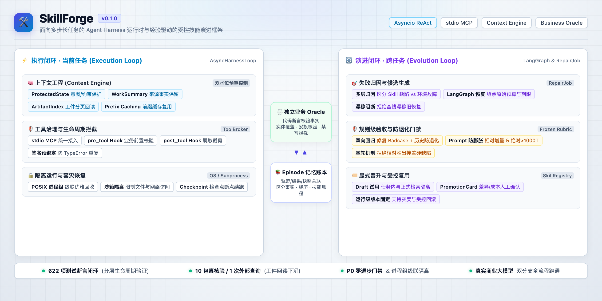
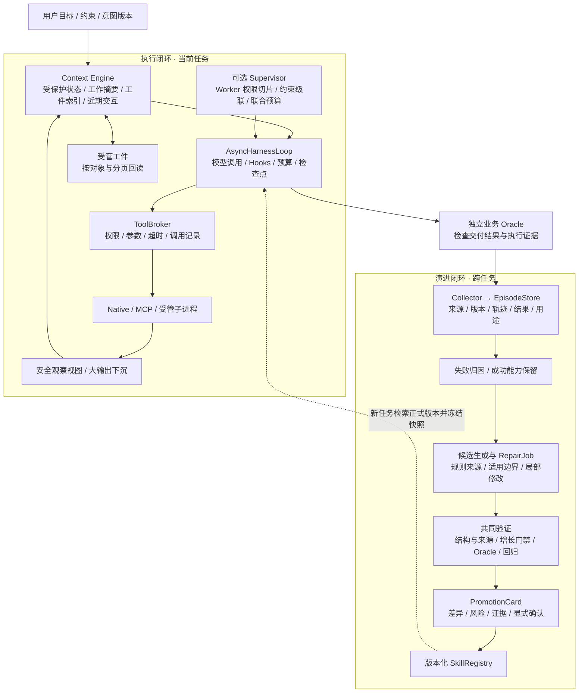

<div align="center">

<p align="center">
  <picture>
    <source media="(prefers-color-scheme: dark)" srcset="assets/skillforge-banner-dark.png">
    
  </picture>
</p>

# 🛠️ SkillForge｜Agent Harness 与受控技能演进

**让 Agent 在长任务中保住目标、证据与执行进度，<br>再把经过验证的纠错经验，变成下一次任务可复用的 Skill。**

*Agent Harness · Episode-Driven Skill Evolution · Evidence-Grounded Evaluation*

[](pyproject.toml)
[](src/skillforge/harness_loop.py)
[](src/skillforge/context_engine/)
[](docs/HARNESS_HOOKS_ACCEPTANCE.md)
[](src/skillforge/supervisor.py)
[](src/skillforge/evaluator/)
[](src/skillforge/evolution_loop.py)

<p>
  <a href="#position">🎯 项目定位</a> •
  <a href="#architecture">🏛️ 双闭环架构</a> •
  <a href="#design">⚙️ 三大核心设计</a> •
  <a href="#validation">📊 演示与验证</a> •
  <a href="#quickstart">🚀 快速上手</a> •
  <a href="#source-map">🗺️ 源码地图</a>
</p>

</div>

---

> **一个贯穿项目的问题：Agent 查了部分包裹，就声称“全单已签收”——系统如何发现错误、保留证据，并让下一次任务避免同类错误？**
>
> SkillForge 把这件事串成一条链：**受控执行 → 独立业务验证 → 经历回收 → 定向修补 → 新旧能力回归 → 人工确认 → 后续任务检索复用**。

<a id="position"></a>
## 1. 项目定位与核心问题

**SkillForge = 通用 Agent 执行与技能演进底座（Harness Infra）＋ 多包裹履约核验压测场。**

底座负责上下文、工具、文件工件、子进程、检查点、Hook 与多 Agent 协作；物流场景负责给这些机制施加具体压力：长列表、多次查询、部分签收、工具故障、用户中途变向和未授权写入。场景使用可重放的合成订单与物流数据，业务验收由独立 Oracle 执行。

项目围绕三条主线展开：

| 主线 | 要解决的问题 | 核心设计 |
|---|---|---|
| **Harness 核心** | 长任务如何保住目标与记忆、管理工具，并在暂停后继续？ | 分层记忆与上下文工程、显式生命周期、工具统一入口、Hooks 与运行恢复 |
| **生成与演进** | 多个 Episode 如何形成一个 Skill？新经历应该修订旧技能，还是新建技能？ | 来源过滤、范围分组、模式挖掘、失败归因、候选生成与受控晋升 |
| **测评与 Benchmark** | 如何判断任务做对了、修改有效了，而且原有能力没有退化？ | 独立 Oracle、规则证据评分、Selection / Test 隔离、配对实验与机制测试 |

**项目的连接点是证据：**工具返回记录执行事实，Oracle 判断业务结果，Episode 保留经历，Candidate 携带来源与验证记录。每一阶段产出的证据，决定下一阶段可以做什么。

---

<a id="architecture"></a>
## 2. 架构设计与双闭环

**当前任务靠工作记忆继续执行；跨任务靠版本化 Skill 复用方法。** 两种时间尺度通过 Oracle 与 Episode 连接。



短需求或对话也可直接生成任务内 **Draft**，先服务当前任务；只有实际执行才形成 Episode。Draft、待验证 Candidate 与正式 Skill 分开管理，当前任务试用与跨任务发布使用不同的准入边界。

---

<a id="design"></a>
## 3. 三大核心设计与实现依据

### 3.1 Harness 核心：记忆、上下文、生命周期与工具管理

#### 任务记忆与上下文工程

工作记忆保存这一次任务的事实、进度与未决项；Episode 保存一次执行的经历；正式 Skill 保存跨任务复用的方法。三者通过来源引用连接，避免把订单状态写进长期规程，或把摘要直接当成业务验收结论。

[`Context Engine`](src/skillforge/context_engine/) 将上下文分成四类，而不是只保留最近几轮：

| 层次 | 保存内容 | 作用 |
|---|---|---|
| `ProtectedState` | 当前目标、意图版本、约束、权限与待审批项 | 从权威任务状态注入，防止摘要改写执行边界 |
| `WorkSummary` | 带来源引用的事实、失败尝试、未决事项 | 保留任务进展，减少反复探索 |
| `MemoryIndex` | 下沉工件的位置、对象范围与展开情况 | 告诉模型还有哪些证据可查 |
| `RecentTurns` | 近期原始交互与工具调用 | 保留当前推理需要的细节 |

**压缩顺序：**大输出下沉为工件 → 较旧观察结果存根化 → 仍超水位时整理闭合历史。工具调用与返回按 ID 配对，未完成交互保留在活跃区；摘要在候选副本中构建，校验后再提交。用户变向时更新权威目标并处理陈旧建议，业务结果继续由 Oracle 检查。

模型需要细节时，通过 [`InspectArtifactTool`](src/skillforge/context_engine/artifact_tool.py) 按对象或分页回读当前运行授权的工件，减少重复访问外部接口。模型可读工件与运行审计证据分别管理。

**缓存友好的请求布局：**固定基础 System、工具定义与 Skill 快照，动态状态向消息尾部追加；静态前缀指纹与压缩阶段 `context_epoch` 分开记录。前者为重复 prefill 提供复用条件，后者控制历史长度。Provider 未返回缓存 usage 时，命中指标保留为空。

> 压缩也有开销：仓库中的短任务对照出现结构开销大于裁剪收益，长任务对照则减少了主请求输入估算。具体数据与复现入口见 [上下文与缓存记录](docs/CONTEXT_CACHE_ACCEPTANCE.md)；本地前缀匹配与服务端真实 KV Cache 命中分别统计。

#### 生命周期与工具管理

[`AsyncHarnessLoop`](src/skillforge/harness_loop.py) 使用原生 `asyncio` 显式驱动“构建上下文 → 调用模型 → 执行工具 → 验证交付”。每一步都可以记录、拦截、暂停和恢复。

- **统一工具入口**：[`ToolBroker`](src/skillforge/runtime.py) 对 Native Tool 与 [`stdio MCP`](src/skillforge/mcp_client.py) 工具执行权限、Schema、签名绑定、预算与超时检查。工具内部 `TypeError` 与模型入参错误分开处理，避免错误重试。
- **文件与执行环境**：运行目录保存工件与检查点；[`ProcessExecutor`](src/skillforge/process_executor.py) 使用独立 POSIX 进程组，取消或超时后依次执行 `SIGTERM → SIGKILL` 清理。OS 访问限制由 [`sandbox.py`](src/skillforge/sandbox.py) 的平台实现承担，进程组负责生命周期管理。
- **运行快照与恢复**：当前运行绑定 Skill / Draft 正文与意图版本；Harness 检查点与 Runtime 持久化状态配合恢复进度，保留已消费预算，并重新校验待执行动作。
- **多 Agent 约束**：[`SupervisorOrchestrator`](src/skillforge/supervisor.py) 为 Worker 分配工具子集、传递父级约束并管理联合预算；Worker 的局部放行不能覆盖父级拒绝。

**取舍：**主循环保留原生 Python 的可追踪性；有界演进恢复复用 LangGraph 检查点基础设施，适配当前 RepairJob 与验证路径，避免混用两套预算和发布状态。

#### Hooks：把业务约束插入执行边界

Hooks 挂在主循环的实际动作前后，通过 `allow / deny / review`、安全观察视图和审计记录参与执行。

| 挂点 | 具体用途 | 执行语义 |
|---|---|---|
| `pre_tool_exec` | 只读约束、业务审批、动作拦截 | 拒绝时不调用 handler；待审批时保存检查点并暂停 |
| `post_tool_exec` | 脱敏、大输出下沉、安全视图 | 模型接收处理后的视图；原始证据留在受信记录中 |
| `before_finalize` | 检查拟交付答案与业务证据 | 自定义 Hook 放行后，仍执行已配置的独立 Oracle |
| `pre_compress / post_compress` | 压缩生命周期观察与诊断 | 压缩规则由 Context Engine 统一维护 |
| `task_end` | 审计、结束通知与清理 | 观察型 Hook 故障留痕，保留主任务结果 |

关键门禁或脱敏 Hook 异常时阻断执行；观察型 Hook 异常记录诊断。没有独立 Oracle 的任务可以正常交付，但业务结果保留为 `unknown`。实现与测试映射见 [Hooks 设计与验证](docs/HARNESS_HOOKS_ACCEPTANCE.md)。

### 3.2 生成与演进：多个 Episode 如何形成一个正式 Skill？

**Episode 是“这次发生了什么”，Skill 是“下一次遇到哪类问题，应该怎样处理”。** 提炼过程要抽取共同步骤、适用前提与失败边界，而不是把多段对话拼接成更长的提示词。

#### 第一步：从实际执行提取 Episode

[`Collector`](src/skillforge/collector.py) 收集任务、意图版本、Skill / Draft 快照、工具参数与返回、执行状态及验证结果，写入 [`EpisodeStore`](src/skillforge/episode.py)。一条经历同时回答：**目标是什么 → 做了哪些动作 → 工具返回什么 → 结果如何 → 判断依据在哪里**。

这些经历有三种使用方式：成功样本提供可复用步骤与能力保留样本；Skill 责任的失败提供缺陷与修补依据；可重放的轨迹可进一步提纯为回归用例提案。环境错误、权限拒绝与未知结果先做归因和诊断，不能一律当作“Skill 写得不好”。需求或对话可直接生成 Draft，但保留原来源类型，试用后才产生 Episode。

#### 第二步：先找同一类经验，再合成候选

批量入口 [`mine_pending`](src/skillforge/pattern_mining.py) 与合成入口 [`mine_candidate`](src/skillforge/evolution_loop.py) 分工如下：

```text
Episode 池
  → 用途过滤：仅 learning；evaluation / heldout 不进入挖掘
  → 按 task_id 去重：同一任务多次运行取最新，避免重试刷支持数
  → 按业务范围、意图版本与工具集合分组
  → 组内按任务表达相似度聚类
  → 检查支持任务数、结果覆盖、多样性和子场景失败
  → 将该簇的成功步骤与失败边界交给模型，合成一个 Candidate
  → 共同验证、回归、显式确认
  → 正式 Skill
```

**先按范围分组，再做相似度聚类：**“查询退款状态”与“执行退款”即使措辞接近，也不能仅凭文本相似就合成同一套操作规程。当前分组键使用业务范围、意图修订号和工具名集合；组内使用本地 embedding，相应模型不可用时回退到词袋表示。

**支持度决定是否值得提炼，验证决定能否发布。** 自动模式挖掘默认要求至少 3 个不同任务、2 种任务表达、可观察多步骤，以及不低于 0.8 的已知结果覆盖率和成功率；这些是可配置的发现阈值。某个子场景持续失败时会弃权，不能被多数成功掩盖。同一批来源、目标版本与策略有指纹记录，重复处理复用候选。

模型接收的是该簇的观察结果与工具证据摘要，产出带适用范围、约束和步骤的 `SKILL.md`。程序绑定 `source_episode_ids`，规则可进一步绑定触发条件、动作、规避的失败、正文锚点与来源引用。**一组经历先得到一个候选，正式状态还要经过验证与确认。**

#### 一个“多经历 → 一条规程”的例子

下面是提炼逻辑示意，5 条经历属于同一只读物流范围，分别来自不同任务；正常签收与部分签收被标为不同子场景：

| 来源经历 | 观察结果 | 对候选规程的贡献 |
|---|---|---|
| E1、E2：全单签收核验成功 | 先取得包裹全集，再逐件核实，最后汇总结论 | 保留完整查询顺序与正常交付能力 |
| E3、E4：部分签收核验成功 | 明确报告仍在途包裹，没有声称全单签收 | 提炼“部分签收”分支与适用条件 |
| E5：部分签收被误报为全签收 | 执行证据与最终结论矛盾，被 Oracle 拦截 | 加入“只有全部包裹有已签收证据，才能声称全单签收”的约束 |

合成后的 Skill 围绕一个职责组织：**获取全量包裹 → 核验每件状态 → 记录未知或故障 → 按全单证据汇总结论**。订单 ID、某次查询时间和个别包裹状态保留在 Episode / 工件中；跨任务复用的是核验方法。

#### 第三步：修订旧 Skill、新建 Skill，还是暂不提炼？

| 情况 | 处理方式 | 验证重点 |
|---|---|---|
| 已有 Skill 的职责仍然成立，但遗漏步骤、边界或异常分支 | **revise**：对目标版本生成修订候选 | 修好目标 Badcase，同时保留旧版正常能力 |
| 出现独立职责，或新增流程有不同前提、工具与评测边界 | **create**：以独立目标新建 Candidate Skill | 定义适用范围和路由边界，通过冷启动验证 |
| 一个 Skill 混合了多种可独立评测的职责 | 提出拆分建议，再确认子技能与路由 | 检查公共步骤、依赖、正常任务及 Badcase，避免拆散连贯流程 |
| 只有未知结果、工具故障、权限阻断，或支持不足 | **abstain / handoff**：记录诊断或等待更多证据 | 不靠改写业务 Skill 掩盖外部问题 |

这里“新建”指独立的 **`SKILL.md` 规程**，可以声明工具依赖；不是把 Episode 直接翻译成自动运行的 Python 脚本。新建 Skill 也不会自动获得写权限。

**当前实现的职责选择是显式、可检查的：**应用传入目标 `skill_name`，批量入口从来源 Skill 名推导目标；目标已存在则修订，不存在则新建。业务范围与拆分意图需要先确定，名称存在性检查不承担全自动业务架构规划。自动恢复链中的拆分仅返回建议，不自行修改正式路由。

#### 单个明确失败，也可以直接进入 RepairJob

批量模式发现与失败修补是两条入口。一个失败已被归因为 Skill 缺陷时，直接由 [`RepairJob`](src/skillforge/repair.py) 使用规范 Episode、旧版正文、诊断和开发反馈生成修订候选，无需等待自动聚类的 3 任务门槛。上一轮拒绝原因反馈给下一次尝试，重复候选 hash 会停止重试。

[`bounded_recovery.py`](src/skillforge/bounded_recovery.py) 将可修失败接入 LangGraph → RepairJob → 共同验证，共享尝试、调用、token 与期限预算；环境、权限和无效评测走诊断或审批路径。新候选最终进入与批量提炼相同的验证和发布边界。

#### 最后一步：验证候选，并让下一次任务真正用上它

- **控制修改体量**：章节增长率 >25% **AND** 净增 >1000 tokens，或全文 >1.20×基线 **AND** 净增 >1000 tokens 时进入 `REVIEW`；冷启动默认正文上限为可配置的 3,000 字符。见 [`prompt_bloat.py`](src/skillforge/evaluator/prompt_bloat.py)。
- **验证新旧能力**：运行正常样本、目标 Badcase、P0 约束与回归；修订与父版在同一评测条件下比较，评测细节见下一节。
- **确认晋升**：CandidateStore 持久化绑定候选内容、规范基线、意图和评测配置的验证记录；[`PromotionCard`](src/skillforge/promotion_card.py) 展示差异与证据，显式确认后发布正式版本。
- **后续检索执行**：[`FutureMemoryRetriever`](src/skillforge/retrieval.py) 根据新任务与上下文查找可用正式 Skill，过滤未晋升候选及不兼容版本；运行时冻结所选正文，再经 Harness / Broker 执行并回收新 Episode。

这构成 **多次经历 → 共性规程 → 候选验证 → 正式复用 → 新经历** 的反馈闭环。规则来源与成对筛选证据见 [技能证据与评测设计](docs/SKILL_EVIDENCE_EVALUATION_ACCEPTANCE.md)。

### 3.3 测评与 Benchmark：分别验证做对、改好和收益来自哪里

**业务是否做对，首先看执行证据。** [物流 Oracle](src/skillforge/scenarios/logistics.py) 的断言覆盖全包裹核验、签收声明真实性、工具故障不编造、`STATUS_ONLY` 约束，以及正确权限拒绝。

LLM Judge 输出逐规则判断与软质量比较结果，评分规则由程序持有：

- **逐规则判断**：Judge 返回 `rule_id / PASS·FAIL·UNKNOWN / evidence / reason`；[`Criteria 协议`](src/skillforge/evaluator/criteria.py) 解析证据，按冻结权重计算得分。模型不能自行修改权重、关键规则或最终分数。
- **硬门禁优先**：关键业务失败不能被更好的文风或更高总分抵消；证据不足保留 `UNKNOWN` 并影响晋升决策。
- **成对筛选**：显式启用后，用相同任务执行父版与候选版，再做位置对调比较；冲突或不确定时保留父版。结果用于 Selection 筛选，锁定 Test 用于独立报告。
- **按类型选测**：过程型、参考型与约束型 Skill 分别检查故障处理、来源忠实度与权限遵从。
- **用途隔离与回归**：底层学习入口校验 Episode 用途；开发反馈与锁定评测分开，候选还需通过 P0 与棘轮回归，保留正常能力。

#### Benchmark 分三种，回答三个问题

| 对照 | 固定什么、改变什么 | 回答的问题 |
|---|---|---|
| **工程机制测试** | scripted 模型与固定工具夹具；注入故障、变向、暂停、越权动作 | 状态、权限、用途隔离和恢复约束是否按设计生效？ |
| **上下文策略消融** | 相同任务与工具；比较完整历史、滑动窗口、SkillForge 分层状态 | 分层状态管理如何影响任务完成、重复查询与输入开销？ |
| **Skill 版本对照** | 相同模型、工具、预算和 Oracle；比较无 Skill / V1 / 仅开发反馈修订的 V2 | 提炼与修订是否改善目标问题，是否损害正常能力？ |

上下文基准见 [`ablation_benchmark.py`](src/skillforge/scenarios/ablation_benchmark.py)。其中模型行为由模拟器定义，用于复现失忆、重复查询与目标遗留；真实模型实验另外记录，二者的结果分别报告。前缀优化另比较动态前缀、稳定前缀、稳定前缀＋压缩，记录客户端匹配与输入估算。

#### 评测为什么能够约束演进？

1. **判据独立于被测答案**：业务 Oracle 根据工具快照和任务约束判断覆盖、签收与故障声明；模型的失败答案不能反过来充当标准答案。LLM Judge 的规则、权重与关键性由程序冻结。
2. **反馈与最终评测分开**：DEV 用于修补，Selection 用于候选筛选，锁定 Test 用于最终报告；按来源任务、派生家族和近重复关系分组。候选修订前冻结划分与判据，不能在看过结果后重分数据来制造未见任务。
3. **逐任务配对比较**：报告改善、退化、不变与异常样本去向，同时覆盖正常场景、目标 Badcase、用户变向和正确拒绝。成功率与证据完整度衡量正确性，重复调用与输入量衡量效率，摘要开销单列。
4. **经历也能变成测试资产**：[`trace_purification.py`](src/skillforge/trace_purification.py) 将轨迹提纯为带来源、输入、工具快照和独立预期的用例提案；缺少独立预期则待审，锁定评测转开发后原成绩不再当作盲测。

**有效性按实验层次解释：**确定性测试说明机制实现符合断言；真实模型配对实验说明所测任务上的收益与退化。已有探索性、事后重分与挑战表保留原标签，客户端 token 估算与 Provider 实际 usage 分列，避免把一次脚本成功或测试数量当成模型能力提升。具体记录见 [评测设计](docs/SKILL_EVIDENCE_EVALUATION_ACCEPTANCE.md) 与 [实验进度](docs/QUICK_GENERATION_EVOLUTION_PROGRESS.md)。

---

<a id="validation"></a>
## 4. 演示与验证

### 三个可运行的业务故事

| 演示 | 观察重点 | 对应设计 |
|---|---|---|
| **长任务核验** | 10 个包裹的完整结果下沉，后续按对象回读工件 | 上下文控长、对象覆盖与证据检索 |
| **中途变向与恢复** | 从处理建议改为只报告状态，重启后继续遵循新约束 | 意图版本、陈旧建议处理与检查点 |
| **纠错后复用** | 部分查询导致错误结论，修补候选经验证与确认后服务新任务 | Oracle → Episode → Candidate → 正式 Skill |

这些演示使用 scripted 模型与合成业务数据，运行实际 Harness、Runtime、Broker 和验证链，适合逐步观察系统行为。入口：[演示脚本](src/skillforge/scenarios/demonstrations.py)。

### 仓库保留的验证记录

| 验证内容 | 已有记录 | 证据入口 |
|---|---|---|
| 规则来源、成对筛选与类型评测 | 48 项专项；含相关模块的回归 178 项通过 | [验收记录](docs/SKILL_EVIDENCE_EVALUATION_ACCEPTANCE.md) / [原始日志](docs/fixtures/pytest_execution.log) |
| 上下文、Hooks、Runtime 与 Supervisor | 相关回归记录 53 项通过 | [原始日志](docs/fixtures/context_cache_pytest.txt) |
| Judge 真实模型校准 | 16 个合成答案、64 项主规则，匹配 52/64（81.25%） | [校准结果](docs/judge_criteria_real_calibration_results.json) |
| 真实模型生命周期 | `glm-5.3-flash` 下分别验证失败修补、目标变向后的修订与复用 | [实验原始结果](docs/p6_real_model_abc_raw_results.json) / [进度记录](docs/QUICK_GENERATION_EVOLUTION_PROGRESS.md) |

各测试套件有重叠，数量不相加。离线机制测试、真实模型调用与 OS 沙箱测试分别记录；真实模型结果来自合成业务的小样本实验，用于展示闭环行为。

---

<a id="quickstart"></a>
## 5. 快速上手

### 安装

```bash
git clone https://github.com/SuperGODOG/skillforge.git
cd skillforge

python3 -m venv .venv
source .venv/bin/activate
pip install -e ".[dev]"
```

Python 3.10+。进程组管理需要 POSIX 环境；OS 沙箱能力按平台探测，macOS Seatbelt 与应用层权限检查分别配置。

### 先看演示

无需外部 API 密钥，按顺序观察“执行 → 变向 → 演进”：

```bash
# 全部三个演示；也可分别使用 --demo 1、2、3
.venv/bin/python3 -m skillforge.scenarios.demonstrations --demo all
```

### 再看断言

```bash
# 三个业务演示的自动化断言
.venv/bin/pytest tests/test_three_demonstrations.py -v

# 上下文、Hook、运行恢复与编排的相关回归
.venv/bin/pytest \
  tests/test_context_engine.py \
  tests/test_continuous_compression_and_restart.py \
  tests/test_harness_loop.py \
  tests/test_harness_business_hooks.py \
  tests/test_context_cache_and_compression.py \
  tests/test_runtime_and_tool_broker.py \
  tests/test_supervisor_orchestration.py -v
```

---

<a id="source-map"></a>
## 6. 源码地图与深入阅读

| 从哪个问题开始读 | 核心代码 | 设计与验证 |
|---|---|---|
| 一轮 Agent 如何执行、拦截和恢复？ | [`harness_loop.py`](src/skillforge/harness_loop.py)、[`runtime.py`](src/skillforge/runtime.py) | [Hooks 设计](docs/HARNESS_HOOKS_ACCEPTANCE.md) |
| 长任务如何压缩历史并保留证据？ | [`context_engine/`](src/skillforge/context_engine/) | [上下文与缓存](docs/CONTEXT_CACHE_ACCEPTANCE.md) |
| Worker 如何继承权限与预算？ | [`supervisor.py`](src/skillforge/supervisor.py) | [架构详解](docs/ARCHITECTURE_V2_DEEP_DIVE.md) |
| MCP 与命令执行如何进入受控工具链？ | [`mcp_client.py`](src/skillforge/mcp_client.py)、[`process_executor.py`](src/skillforge/process_executor.py)、[`sandbox.py`](src/skillforge/sandbox.py) | [模块交接记录](docs/m1_m4_handover_diff.md) |
| 多个 Episode 如何聚合为一个候选？ | [`pattern_mining.py`](src/skillforge/pattern_mining.py)、[`evolution_loop.py`](src/skillforge/evolution_loop.py) | [聚类与幂等测试](tests/test_pattern_mining.py)、[候选晋升测试](tests/test_mining_and_promotion.py) |
| 失败如何变成可复用 Skill？ | [`repair.py`](src/skillforge/repair.py)、[`evolution_loop.py`](src/skillforge/evolution_loop.py)、[`bounded_recovery.py`](src/skillforge/bounded_recovery.py) | [Episode 与候选指南](docs/EPISODE_AND_CANDIDATE_GUIDE.md) |
| Judge 如何提供可核对的判断？ | [`evaluator/criteria.py`](src/skillforge/evaluator/criteria.py)、[`evaluator/`](src/skillforge/evaluator/) | [Judge 规则指南](docs/JUDGE_CRITERIA_GUIDE.md)、[证据与评测设计](docs/SKILL_EVIDENCE_EVALUATION_ACCEPTANCE.md) |
| 谁决定候选可以晋升？ | [`promotion_card.py`](src/skillforge/promotion_card.py)、[`retrieval.py`](src/skillforge/retrieval.py) | [Receipt 与局部修补](docs/NARROW_REPAIR_AND_RECEIPT_GUIDE.md) |

完整业务时序见 [任务状态驱动的上下文与技能演进](docs/task_state_driven_context_and_skill_evolution_walkthrough.md)。

---

## 致谢与交流

项目基于 [HelloAgents](https://github.com/jjyaoao/HelloAgents) 与 LangGraph 等组件构建，围绕任务状态、业务证据与受控技能演进组织执行链。欢迎通过 Issue 与 PR 交流 Agent Harness、上下文工程和技能评测实践。
