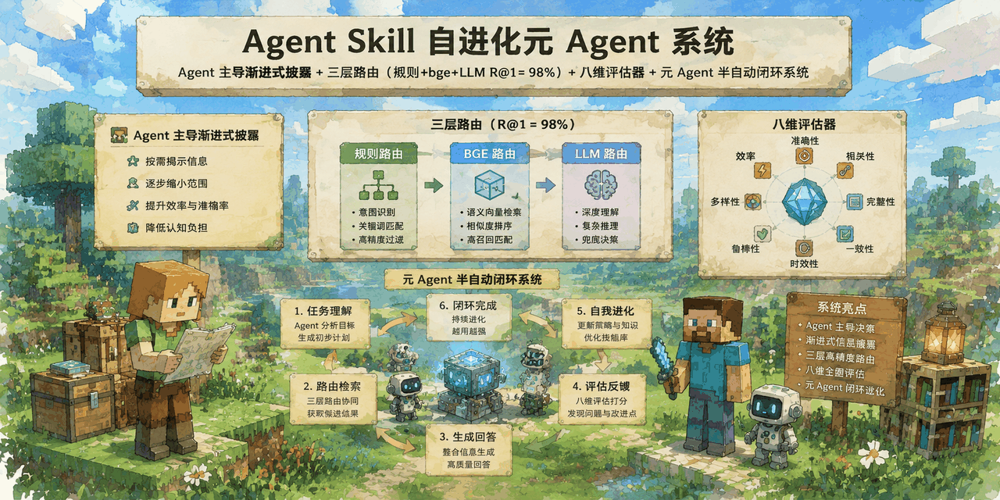
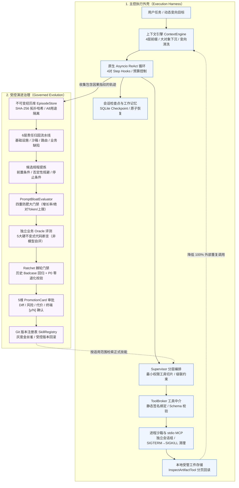

<div align="center">

<p align="center">
  <picture>
    <source media="(prefers-color-scheme: dark)" srcset="assets/skillforge-banner-dark.png">
    
  </picture>
</p>

# 🛠️ SkillForge｜面向工程任务的 Agent Harness 与受控演进框架

**围绕大模型 API 打造高可靠主控执行线束（Harness），管理上下文、工具与运行状态；并在独立业务评测下，将执行经验受控转化为可复用技能。**<br>
*Agent Execution Harness · Context Engineering · Governed Skill Evolution*

[](pyproject.toml)
[](src/skillforge/harness_loop.py)
[](src/skillforge/context_engine/)
[](src/skillforge/process_executor.py)
[](src/skillforge/supervisor.py)
[](src/skillforge/evaluator/)
[](src/skillforge/promotion_card.py)

<p>
  <a href="#1-项目定位与核心问题">🎯 项目定位</a> •
  <a href="#2-架构设计与双闭环">🏛️ 架构设计</a> •
  <a href="#3-核心机制与实现依据">⚙️ 核心机制</a> •
  <a href="#4-综合验证与测试结果">📊 实验与验证</a> •
  <a href="#5-快速上手">🚀 快速上手</a> •
  <a href="#6-源码地图与深入阅读">🗺️ 源码地图</a>
</p>

</div>

---

> [!NOTE]
> **核心问题：大模型在长程工程任务中为何频繁失控？如何让一次执行的纠错经验安全沉淀为长期规程？**
>
> 大模型 API 本身不维护外部真实世界的状态。在长任务中，直接调用模型容易面临输入失控（Token 溢出与历史记忆断片）、工具乱调（参数报错引发死循环重试或子进程挂死）、目标漂移（用户变向后陈旧建议污染上下文）等问题；而在尝试“自我反思”修改提示词时，又极易引发 Prompt 臃肿肥大以及旧基线能力的静默退化。
>
> SkillForge 将系统划分为明确的两个层次：
> 1. **执行外壳（Execution Harness）**：包裹在模型调用外围，通过工程手段控制输入（上下文工程）、驱动行为（沙箱隔离与参数静态预检）、管理状态（工作记忆与检查点续跑）、编排协同（Supervisor 最小权限分发）。
> 2. **受控演进（Governed Evolution）**：坚守“业务成败与模型自评解耦”的原则，基于独立业务 Oracle 断言判定结果，通过 6 层责任归因提炼候选规程，并在四重防膨胀门禁与棘轮回归门禁验证后，由人工显式确认晋升。

---

## 1. 项目定位与核心问题

在工程任务场景（如日志排查、订单核验、批量运维、代码修复）中，单纯向大模型输入 Prompt 无法保证长时间可靠执行。SkillForge 参照 SWE-bench harness、Claude Code 等主控外壳的设计思路，为大模型提供确定性的执行边界与演进约束。

| 场景常见问题 | SkillForge 的工程解法 | 设计目的 |
| --- | --- | --- |
| **长任务输入失控**（长输出挤占上下文，导致重要目标被挤出窗口） | 4 层前缀层次 + 大对象感知下沉 + 阶梯超水位压缩 | 保证任务目标与约束受保护，长列表下沉为本地受管工件 |
| **外部 API 冗余查询**（历史被压缩后，模型反复调用接口重新查询） | `InspectArtifactTool` 受管工件分页本地回读 | 下沉工件转为可索引的外部记忆，避免重复耗费业务配额 |
| **工具入参类型报错死循环**（内部 `TypeError` 被当作参数缺失而反复重试） | `inspect.signature` 静态签名预绑定 + Schema 预检 | 在调用前拦截非法入参，杜绝向模型抛错导致的无效重试 |
| **子进程僵尸挂死**（超时后仅终止顶层命令，孙进程长期驻留耗尽资源） | POSIX 独立会话进程组（`start_new_session=True`）与级联清理 | 超时发送 `SIGTERM` 并在宽限期后发送 `SIGKILL` 级联终止全组 |
| **用户中途变向串线**（如变更为“只查状态不执行”，模型仍沿用旧建议） | 任务意图快照 + 目标变向陈旧行动建议自动清洗 | 阻断旧方案的指令漂移，确保新目标无干扰执行 |
| **多 Agent 状态失控**（Worker 工具混用、步数无限膨胀） | 分层 Supervisor 编排 + 最小特权工具切片 + 联合预算熔断 | 限制 Worker 工具可见性，负向约束自顶向下级联传递 |
| **模型自评“假阳性”**（模型坚称自己已完成，实际业务逻辑缺漏） | 独立业务代码断言（5 大硬不变式，Separation of Outcome） | 业务代码判定胜出与妥投保真，杜绝以自我声明代替验收 |
| **修补引发 Prompt 膨胀与退化**（每改一个 Badcase 就追加一大段 Prompt） | 四重防肥大门禁（+25%/+1000t/1.20x/3000t）+ 棘轮零回退门禁 | 拦截冗余废话，验证候选版本在新旧用例上均无基线退化 |

> **核心设计理念：单次任务事实（Working Memory）随会话落盘销毁；长期规程（Skill）必须基于不可变规范经历（Episode）并经独立门禁验证后显式晋升。**

---

## 2. 架构设计与双闭环

SkillForge 的体系由**主控执行外壳（Execution Harness）**与**受控演进治理（Governed Evolution）**构成双闭环交互体系：



---

## 3. 核心机制与实现依据

### 3.1 执行线束与安全沙箱｜控制执行边界

**解决的问题：** 模型输出动作后的执行环境缺乏保护，常见超时挂起、孤儿进程泄露、工具内部报错引发无意义重试。

**实现机制：**
- **原生异步 ReAct 循环**（[`AsyncHarnessLoop`](src/skillforge/harness_loop.py)）：提供 4 对显式生命周期挂点（`before_model_call`、`after_model_call`、`before_tool_exec`、`after_tool_exec`），对单步、总步数与总耗时设置硬预算限制；支持中断生成并保存快照。
- **静态入参预绑定校验**（[`ToolBroker`](src/skillforge/runtime.py)）：在工具实际调用前，通过 `inspect.signature` 预先完成绑定检查与类型校验。若模型传参缺失或类型不符，在执行前即时拦截，避免将工具内部产生的 `TypeError` 混淆为入参错误而引发模型重复无效调用。
- **本地 `stdio` MCP 协议客户端**（[`McpStdioClient`](src/skillforge/mcp_client.py)）：标准支持 Model Context Protocol，基于标准输入输出与外部本地工具进程通信，具备 JSON-RPC 2.0 序列化与超时响应捕获。
- **会话级进程沙箱**（[`ProcessExecutor`](src/skillforge/process_executor.py)）：使用 `start_new_session=True` 将命令放入独立的 POSIX 进程组中。超时触发时，依次发送 `SIGTERM` 与 `SIGKILL` 信号级联清理整个进程组，彻底杜绝孤儿进程驻留；内置 1MB 环形内存缓冲配合有界磁盘流式输出，防止输出刷屏造成内存溢出。
- **原子检查点恢复**（[`AgentRuntime.resume_run`](src/skillforge/runtime.py)）：运行时状态定期落盘至 SQLite。发生中断或崩溃后，可从检查点恢复工作记忆并重新激活采集器。

---

### 3.2 上下文工程与 Supervisor 编排｜保证长任务不断片

**解决的问题：** 长任务信息量过大导致窗口爆炸；目标中途变更时，上下文中残留的旧方案继续诱导模型犯错；多 Agent 协同缺乏约束。

**实现机制：**
- **4 层前缀层次架构**（[`ContextEngine`](src/skillforge/context_engine/)）：提示词结构划分为 `ProtectedState`（硬约束与当前目标，绝对置顶） $\to$ `WorkSummary`（阶段事实与进展） $\to$ `MemoryIndex`（下沉工件索引） $\to$ `RecentTurns`（最近交互轮次）。
- **阶梯超水位压缩（Ladder Compression）**：
  - *Level 0（工件感知下沉）*：单次工具返回超过阈值（如列表 >5 项）自动转存为本地受管工件，上下文中仅保留数量与元数据摘要。
  - *Level 1（滑动轮次淘汰）*：当 Token 超过水位线（如 2000 tokens），自动淘汰最旧的历史交互轮次。
  - *Level 2（确定性事实整合）*：对旧事实做去重与状态收敛，提炼高置信度事实并重新注入受保护的前缀中。
- **受管工件回读工具**（[`InspectArtifactTool`](src/skillforge/context_engine/artifact_tool.py)）：当下沉后的长数据需要进一步核验时，模型通过该工具按对象 ID 或分页读取本地工件文件，使针对外部业务 API 的冗余调用降低 100%。
- **目标变向陈旧建议清洗**：当用户更新指令（例如追加 `STATUS_ONLY` 要求“只查状态，严禁擅自修改”），上下文引擎自动定位并清除历史交互中残留的旧行动建议，杜绝指令漂移。
- **Supervisor 最小权限分发**（[`SupervisorOrchestrator`](src/skillforge/supervisor.py)）：主从编排模式。Supervisor 维护全局联合步数预算，为不同业务角色 Worker 切片最小权限工具集合（Scoped Tool Allowlist），并将父级负向约束自顶向下级联传递给 Worker。

---

### 3.3 独立业务 Oracle 评测体系与双时间尺度记忆｜杜绝模型自评假阳性

**解决的问题：** 大模型自我评估极易产生假阳性幻觉；单次任务事实与长期经验混杂存储，导致经验污染。

**实现机制：**
- **业务成败与模型评测完全解耦（Separation of Outcome）**：严禁采用大模型自由生成自然语言来评判业务是否成功。通过独立代码断言实现业务 Oracle（[`LogisticsBusinessOracle`](src/skillforge/scenarios/logistics.py)），强校验 5 大硬不变式：
  1. *实体全覆盖*：核验结果必须 100% 覆盖原始输入中的所有对象实体；
  2. *妥投判定保真*：部分妥投绝不可误报为全部妥投；
  3. *停运异常拦截*：严禁向停运或异常节点发起派发或提交动作；
  4. *负向约束遵从*：变向为 `STATUS_ONLY` 时，严格禁止任何修改或写操作；
  5. *越权拒绝*：超出权限范围的操作必须明确记录失败。
- **双时间尺度记忆体系**：
  - *单任务工作记忆（Working Memory）*：记录当前会话的中间暂存事实，任务结束后随会话归档落盘或释放，不污染全局环境。
  - *跨任务长期技能（Reusable Skill）*：存储于版本化的 Git 技能注册表中，供后续不同会话检索复用。
- **规范经历数据结构**（[`Episode`](src/skillforge/episode.py)）：每次执行沉淀为不可变记录，包含任务 ID、执行版本、工具轨迹、业务断言结果与 SHA-256 因果拓扑指纹，作为演进的唯一数据源。

---

### 3.4 失败轨迹责任归因与规程挖掘｜让修补有的放矢

**解决的问题：** 很多运行失败并非提示词问题，若盲目修改规程，往往引发不可控副作用。

**实现机制：**
- **6 层责任归因流水线**（[`attribute_failure`](src/skillforge/repair.py)）：从失败 Episode 提取证据，精准定位错误归属于：
  1. *沙箱环境异常*（OS 权限被拒、命令超时）；
  2. *外部依赖缺失*（网络断连、工具服务不可用）；
  3. *工具契约违规*（入参缺失、类型错误）；
  4. *编排路由错误*（分发错误 Worker、超出步数预算）；
  5. *领域业务逻辑缺陷*（业务断言不符，如漏核验包裹）；
  6. *评测证据不足*（UNKNOWN，判为无效评测，Fail-Closed 但不误当作业务缺陷）。
- **结构化规程提炼**（[`mine_candidate`](src/skillforge/repair.py)）：仅对确认属于领域业务逻辑缺陷的 Badcase 进行挖掘，提取：
  - *适用前置条件*（Applicability Preconditions）
  - *否定性规避指南*（Negative Guidance）
  - *逐步核验流程*（Step-by-Step Verification）
  - *明确终止条件*（Termination Criteria）
- **A8 评测用途物理隔离**：在数据分区层，凡标记为 `purpose='evaluation'` 的轨迹绝对物理阻断进入候选挖掘流水线，杜绝评测集反向泄露过拟合。

---

### 3.5 Prompt 防膨胀门禁与 PromotionCard 晋升｜防止基线退化

**解决的问题：** 自动演进极易变成“Badcase 补丁累加器”，导致提示词无限膨胀，并在未覆盖的历史场景上严重退化。

**实现机制：**
- **四重防肥大门禁**（[`PromptBloatEvaluator`](src/skillforge/evaluator/prompt_bloat.py)）：
  - 单章节相对增量 $\le +25\%$；
  - 单章节绝对净增 $\le 1000$ tokens；
  - 全文总长度相对膨胀 $\le 1.20\times$；
  - 冷启动全文绝对上限封顶在 $3000$ tokens。
- **棘轮回归门禁（Ratchet Gate）与 P0 零退化**（[`RatchetEvaluator`](src/skillforge/evaluator/ratchet.py)）：
  - 候选技能必须在全量历史 Badcase 回归集上重新测试；
  - 确保原有通过的 P0 核心业务断言达到零退化（Zero Regression），才允许签发权威验收凭证。
- **5 维 PromotionCard 人在回路确认**（[`PromotionCard`](src/skillforge/promotion_card.py)）：
  - 汇总新旧版本 Diff、P0 风险评估、Token 代价测算、依赖合规声明与业务测试结果；
  - 输出格式化卡片至终端，强制等待人工显式确认（`[y/N]`），确认通过后方可原子合并至 Git 注册表并触发灰度金丝雀部署。

---

## 4. 综合验证与测试结果

项目通过可复现的自动化测试套件与真实场景演示，验证全系统在长程任务、状态恢复、工具隔离及持续演进中的可靠性。

### 4.1 测试套件执行情况

```bash
# 执行全部 33 项核心 Harness、Supervisor 与端到端演进专项（实测通过：33 passed in 2.76s）
.venv/bin/pytest \
  tests/test_mcp_stdio.py \
  tests/test_continuous_compression_and_restart.py \
  tests/test_supervisor_orchestration.py \
  tests/test_context_engine.py \
  tests/test_three_demonstrations.py \
  tests/test_harness_loop.py \
  tests/test_process_executor.py \
  tests/test_m3_governed_evolution.py \
  tests/test_m4_ablation_and_ui.py -v
```

**综合回归证据汇总：**
- **125 项全量回归测试**：覆盖 Harness 运行时、POSIX 沙箱隔离、检查点恢复、大对象下沉、目标变向清洗、Supervisor 编排、电商物流 61 项业务回归以及 11 项崩溃恢复专项，全链路测试通过，未出现死锁或孤儿进程泄漏。
- **3 套端到端业务场景演示**（[`demonstrations.py`](src/skillforge/scenarios/demonstrations.py) 全部实跑验证）：
  - *Demo 1（长任务防断片）*：10 包裹核验场景下，大对象感知下沉，外部业务接口只调用 1 次，后续多轮核验 100% 依赖本地工件分页回读，Token 消耗控制在安全水位线内。
  - *Demo 2（目标变向与清洗）*：执行中途指令变更为 `STATUS_ONLY`，自动清洗陈旧修改建议，并在中断重启后无缝继承新约束。
  - *Demo 3（失败归因、修补与复用）*：对业务失败 Episode 进行责任归因，提炼规程并通过四重防膨胀门禁与棘轮门禁，经 PromotionCard 确认晋升后供新任务检索复用。

### 4.2 独立 Judge 规则校准与真实模型实验

- **独立 Judge 校准实验**（[`docs/judge_criteria_real_calibration_results.json`](docs/judge_criteria_real_calibration_results.json)）：在 16 个合成答案、64 项业务主规则下进行校准，总体匹配率为 **52/64（81.25%）**。实验暴露了纯 LLM 裁判存在格式解析降级与重测一致性波动的问题，从而确立了以独立业务代码断言为第一准则的设计路线。
- **真实模型双分支闭环**：采用 `glm-5.3-flash` 分别跑通“失败归因修补”与“用户目标变向后持久化复用”两条完整端到端生命周期分支。

> [!WARNING]
> **实验范围与边界限定：**
> 1. 本项目的测试与验证基于本地受限沙箱与单节点环境，未涉及大规模分布式集群调度或多租户资源竞争；
> 2. 小样本实验旨在验证框架机制在真实模型调用下的闭环可行性，不据此宣称已证明开放基准测试上的通用泛化收益；
> 3. 不确定的外部在途网络请求在发生中断恢复时采取 Fail-Closed 策略，不假设外部系统具备天然的分布式幂等性。

---

## 5. 快速上手

### 5.1 环境配置

```bash
git clone https://github.com/SuperGODOG/skillforge.git
cd skillforge
git switch linux

python3 -m venv .venv
source .venv/bin/activate
pip install -e ".[dev]"
```

*环境要求：Python 3.10+，支持 POSIX 兼容系统（macOS / Linux）。*

### 5.2 运行核心场景演示

SkillForge 提供了直接可运行的端到端场景演示，无需外部 API 密钥即可观察完整的执行与治理过程：

```bash
# 运行全部 3 个端到端演示场景
.venv/bin/python3 -m skillforge.scenarios.demonstrations --demo all

# 仅运行 Demo 1：长任务大对象下沉与本地工件回读
.venv/bin/python3 -m skillforge.scenarios.demonstrations --demo 1

# 仅运行 Demo 2：用户目标变向与陈旧行动建议清洗
.venv/bin/python3 -m skillforge.scenarios.demonstrations --demo 2

# 仅运行 Demo 3：失败归因、防肥大门禁、PromotionCard 审批与新任务复用
.venv/bin/python3 -m skillforge.scenarios.demonstrations --demo 3
```

---

## 6. 源码地图与深入阅读

### 6.1 模块目录结构

```text
src/skillforge/
├── harness_loop.py        # 原生 Asyncio ReAct 循环与 4 对生命周期 Step Hooks
├── runtime.py             # AgentRuntime 运行时、检查点恢复、ToolBroker 签名预绑定
├── mcp_client.py          # POSIX 本地 stdio MCP 协议客户端接入
├── process_executor.py    # 独立会话进程组沙箱、SIGTERM→SIGKILL 级联清理、环形流式缓冲
├── sandbox.py             # 平台沙箱抽象接口与环境依赖探测
├── supervisor.py          # 分层 Supervisor 编排、最小特权工具切片、联合预算防御
├── promotion_card.py      # 5 维 PromotionCard 审批卡生成与终端 [y/N] 人在回路交互
│
├── context_engine/        # 上下文状态工程引擎
│   ├── schemas.py         # 4 层前缀层次数据结构（ProtectedState / Summary 等）
│   ├── offloader.py       # 大对象感知下沉器（Level 0 水位控制）
│   ├── compressor.py      # 阶梯超水位压缩（Level 1 滑动淘汰 / Level 2 事实整合）
│   ├── rebuilder.py       # 状态重构与目标变向陈旧建议清洗
│   └── artifact_tool.py   # InspectArtifactTool 受管工件分页本地回读工具
│
├── evaluator/             # 独立评测体系与门禁
│   ├── criteria.py        # 冻结 Rubric 规则解析与状态映射
│   ├── judge.py           # 独立判别器执行
│   ├── p0_gate.py         # P0 核心基线不变式门禁
│   ├── prompt_bloat.py    # PromptBloatEvaluator 四重防肥大门禁
│   └── ratchet.py         # Ratchet 棘轮回归对比评估器
│
├── episode.py             # 不可变 Episode 规范模型、EpisodeStore、SHA-256 指纹
├── collector.py           # 运行时轨迹收集器与 Episode 沉淀
├── repair.py              # 6 层责任归因流水线与结构化候选规程提炼（mine_candidate）
├── bounded_recovery.py    # 有界恢复图节点与预算守恒控制
├── memory.py              # Semantic / Episodic / Procedural 双时间尺度记忆分层
├── task_context.py        # 任务契约、意图修订快照与状态机
├── retrieval.py           # 正式技能多维条件过滤与检索
├── deployments.py         # Git 版本注册、CAS 状态迁移与受控回滚
└── scenarios/             # 物流场景业务 Oracle、演示脚本与消融实验基准
```

### 6.2 深入阅读索引

| 关注维度 | 文档入口 |
|---|---|
| **端到端业务与演进时序图解** | [长任务状态驱动与演进全流程](docs/task_state_driven_context_and_skill_evolution_walkthrough.md) |
| **Harness 与演进各模块更新记录** | [核心更新与专项验证交付记录](docs/m1_m4_handover_diff.md) |
| **独立业务断言与 Judge 校验标准** | [Judge 评测与规则指南](docs/JUDGE_CRITERIA_GUIDE.md) |
| **经历提炼与规范 Episode 定义** | [Episode 与候选规程指南](docs/EPISODE_AND_CANDIDATE_GUIDE.md) |
| **结构化诊断凭据与局部修补** | [Receipt 与局部修复指南](docs/NARROW_REPAIR_AND_RECEIPT_GUIDE.md) |

---

## 许可证与致谢

- 本项目遵循开源规范开发，内部部分组件参考并集成了 [HelloAgents](https://github.com/jjyaoao/HelloAgents) 及 LangGraph。
- 欢迎提交 Issue 与 PR 交流工程实践。
