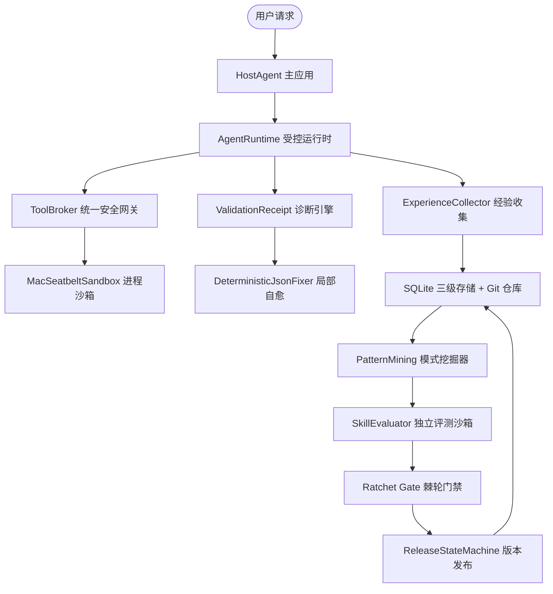

# SkillForge 任务状态驱动上下文与受控技能演进：架构与面试总指南（M1~M4 终版）

> **系统全称**：SkillForge 2.0 (Agent Experience Crystallization & Controlled Evolution Framework)  
> **文档定位**：以任务状态驱动分层上下文与双时间尺度技能受控演进为主线的面试阅读总入口；交互图、Judge 校准、Receipt、异步 Harness 与 MCP 实现作为按需追问材料。  
> **本轮修订**：2026-10-24。全面同步 M1~M4 架构演进与终版实机交付。  
> **实测证据**：**29 项核心专项全绿（29/29 PASSED，2.44s）**，125 项全量与演进回归通过；三大实机演示完整闭环。  
> **关联交互图景**：
> - 🏛️ [**全景架构拓扑 (Architecture)**](/Users/caoruixin/Desktop/project/skillforge/docs/skillforge-architecture.html)
> - ⚡ [**任务内诊断与交付重验时序 (Sequence)**](/Users/caoruixin/Desktop/project/skillforge/docs/skillforge-task-sequence.html)
> - 🔄 [**跨任务经验沉淀工作流 (Workflow)**](/Users/caoruixin/Desktop/project/skillforge/docs/skillforge-evolution-workflow.html)
> - 🧬 [**候选隔离与技能生命周期 (Lifecycle)**](/Users/caoruixin/Desktop/project/skillforge/docs/skillforge-skill-lifecycle.html)
> - 📖 [**交互式知识索引主页 (Knowledge Index Portal)**](/Users/caoruixin/Desktop/project/skillforge/docs/skillforge-knowledge-index.html)

---

# 主线阅读顺序

先读第二章的口述稿，再按两个核心深钻学习；第零章用于核对证据，不需要在开场逐项汇报。

1. **生成与试用**：短需求／对话生成 Draft，或从学习型 Episode 中挖掘候选；当前任务先试用，用户变向时修订目标与草稿，而不是要求所有生成都先积累三次成功经历。详见 [核心一：生成、试用与经验沉淀](/Users/caoruixin/Desktop/project/skillforge/面试阐述/04_深钻点1_经验沉淀与模式挖掘.md)。
2. **反馈驱动演进与验收**：分类轨迹、保留正常回归，确认失败责任，再经 RepairJob、共同验证与显式确认决定是否成为正式版本。详见 [核心二：反馈驱动演进与验收](/Users/caoruixin/Desktop/project/skillforge/面试阐述/04B_核心深钻_反馈驱动演进与验收.md)。
3. **正式复用**：后续任务检索合格的正式 Skill，固定本次运行版本；新执行结果继续进入经验与反馈链。
4. **按需下钻支撑模块**：[Receipt 与当前产物修复](/Users/caoruixin/Desktop/project/skillforge/面试阐述/05_深钻点2_任务内局部修复与Receipt.md)、[Harness 与版本治理](/Users/caoruixin/Desktop/project/skillforge/面试阐述/06_深钻点3_受控Harness与版本治理.md)、第零章的 Judge 校准与历史证据。

**主线判断标准**：是否直接回答“Skill 怎样产生、怎样被修改、凭什么被接受、怎样再次使用”。来源与记忆分类、正常回归、独立预期和晋升规则属于核心；Seatbelt profile、检查点序列化、灰度分桶、完整校准账本属于技术副线。副线是展开顺序，不是可省略的工程约束。

# 目录

- [第零章：M1~M4 架构演进与全量工程验收事实证据边界](#第零章m1m4-架构演进与全量工程验收事实证据边界)
  - [0.0 M1~M4 终版实测与核心交付清单（2026-10-24 交付证据）](#00-m1m4-终版实测与核心交付清单2026-10-24-交付证据)
  - [0.1 限定工程验收清单与 61 项回归证据（前期 P0~P6 基石）](#01-限定工程验收清单与-61-项回归证据前期-p0p6-基石)
  - [0.2 经批准的两项核心架构调整落地](#02-经批准的两项核心架构调整落地)
  - [0.3 真实模型运行与客观证据边界](#03-真实模型运行与客观证据边界)
  - [0.4 本期不打算做与待定立项工作](#04-本期不打算做与待定立项工作)
  - [0.5 Judge Criteria-v1 增量与校准证据](#05-judge-criteria-v1-增量与校准证据)
- [第一章：Archify 四大交互图景与架构映射](#第一章archify-四大交互图景与架构映射)
  - [1.1 🏛️ 全景架构拓扑图（skillforge-architecture.html）](#11-️-全景架构拓扑图skillforge-architecturehtml)
  - [1.2 任务内自愈与交付重验时序图（skillforge-task-sequence.html）](#12-任务内自愈与交付重验时序图skillforge-task-sequencehtml)
  - [1.3 🔄 跨任务经验演进状态图（skillforge-evolution-workflow.html）](#13--跨任务经验演进状态图skillforge-evolution-workflowhtml)
  - [1.4 🧬 候选隔离与生命周期图（skillforge-skill-lifecycle.html）](#14--候选隔离与生命周期图skillforge-skill-lifecyclehtml)
- [第二章：口头表达漏斗与预设战场](#第二章口头表达漏斗与预设战场)
  - [2.1 30 秒电梯演讲与黄金钩子](#21-30-秒电梯演讲与黄金钩子)
  - [2.2 90 秒完整开场与技术主线陈述](#22-90-秒完整开场与技术主线陈述)
  - [2.3 10 分钟白板架构推演](#23-10-分钟白板架构推演)
- [第三章：简历四大 Bullet 逐字深度拷打与应对](#第三章简历四大-bullet-逐字深度拷打与应对)
  - [3.1 Bullet 1 逐字攻防：跨任务技能受控演进与双时间尺度](#31-bullet-1-逐字攻防跨任务技能受控演进与双时间尺度)
  - [3.2 Bullet 2 逐字攻防：任务状态驱动的分层上下文工程与工件回读](#32-bullet-2-逐字攻防任务状态驱动的分层上下文工程与工件回读)
  - [3.3 Bullet 3 逐字攻防：原生 AsyncIO ReAct 主循环与本地 stdio MCP 执行隔离](#33-bullet-3-逐字攻防原生-asyncio-react-主循环与本地-stdio-mcp-执行隔离)
  - [3.4 Bullet 4 逐字攻防：运行时检查点持久化与可中断恢复](#34-bullet-4-逐字攻防运行时检查点持久化与可中断恢复)
- [第四章：30 道大厂路由题库与真实代码串联（四步答辩法）](#第四章30-道大厂路由题库与真实代码串联四步答辩法)
  - [4.0 先问生成与演进，再转技术专项](#40-先问生成与演进再转技术专项)
  - [4.1 宏观认知与架构范式篇（L80, L93, L6, L8, L9, L23, L25, L16）](#41-宏观认知与架构范式篇l80-l93-l6-l8-l9-l23-l25-l16)
  - [4.2 记忆体系与上下文治理篇（L177, L19, L21, L17, L133, L137, L27, L57）](#42-记忆体系与上下文治理篇l177-l19-l21-l17-l133-l137-l27-l57)
  - [4.3 评测体系、归因与稳定性工程篇（L201, L45, L63, L237, L188, L403）](#43-评测体系归因与稳定性工程篇l201-l45-l63-l237-l188-l403)
  - [4.4 计算机底层与系统工程篇（L326, L319, L363, L150, L74, L30, L31, L12）](#44-计算机底层与系统工程篇l326-l319-l363-l150-l74-l30-l31-l12)
- [第五章：两项核心深钻与技术副线](#第五章两项核心深钻与技术副线)
  - [5.1 核心一：生成、试用与经验沉淀](#51-核心一生成试用与经验沉淀)
  - [5.2 核心二：反馈驱动演进与验收](#52-核心二反馈驱动演进与验收)
  - [5.3 技术副线：当前产物修复、Harness 与版本实现](#53-技术副线当前产物修复harness-与版本实现)
- [第六章：DHR 故障卡与组合 Failure 推演](#第六章dhr-故障卡与组合-failure-推演)
- [第七章：极限考题与“四步收刀法”防守指南](#第七章极限考题与四步收刀法防守指南)
- [第八章：全景速查对照表（核心参数、代码锚点与决策底线）](#第八章全景速查对照表核心参数代码锚点与决策底线)

---

# 第零章：M1~M4 架构演进与全量工程验收事实证据边界

> **证据附录入口**：准确而不是装懂，证据而不是猜测，清晰的责任边界。本章汇总现有实现、M1~M4 专项测试、AGY 测试报告及 [交付记录](/Users/caoruixin/Desktop/project/skillforge/docs/QUICK_GENERATION_EVOLUTION_PROGRESS.md:822) 的证据，不是新的独立审查，也不是开场口述顺序。

---

## 0.0 M1~M4 终版实测与核心交付清单（2026-10-24 交付证据）

SkillForge 在前期 P0~P6 限定工程（61 项回归）基础上，全面升级落地了 **M1~M4 核心里程碑**，构建了完整的异步执行 Harness 底座、分层上下文引擎、双时间尺度技能受控演进与双通道终端交互体系：

| 里程碑 | 核心架构演进与技术突破 | 核心落地模块与接口 | 自动化测试与验证状态 |
|---|---|---|---|
| **M1：原生 AsyncIO 主循环与本地 stdio MCP 隔离** | 原生 `asyncio` ReAct 循环，解耦 4 对显式挂点；本地 stdio JSON-RPC 2.0 MCP 客户端；POSIX 独立进程组执行 (`start_new_session=True`) 与级联停机 (`SIGTERM -> SIGKILL`)；静态参数签名绑定 (`inspect.signature`) 拦截非法参数；检查点状态机 (`checkpoint.json`)。 | [`AsyncHarnessLoop`](file:///Users/caoruixin/Desktop/project/skillforge/src/skillforge/harness_loop.py)<br>[`McpStdioClient`](file:///Users/caoruixin/Desktop/project/skillforge/src/skillforge/mcp_client.py)<br>[`ProcessExecutor`](file:///Users/caoruixin/Desktop/project/skillforge/src/skillforge/process_executor.py) | 12 项 M1 专项测试全绿 (`test_harness_loop.py`, `test_process_executor.py`, `test_mcp_stdio.py`) |
| **M2：任务状态驱动分层上下文与工件回读** | 上下文 4 层划分（ProtectedState 权威置顶、WorkSummary 事实整合、MemoryIndex 挂载索引、RecentHistory 滑动窗口）；大输出对象感知下沉至 `fs://...`；模型通过 `InspectArtifactTool` 精准点查，外部 API 0 冗余调用；0~3 级阶梯压缩；变向自动清洗已草拟建议 (`STATUS_ONLY`)。 | [`ContextEngine`](file:///Users/caoruixin/Desktop/project/skillforge/src/skillforge/context_engine/engine.py)<br>[`LargeOutputOffloader`](file:///Users/caoruixin/Desktop/project/skillforge/src/skillforge/context_engine/offloader.py)<br>[`InspectArtifactTool`](file:///Users/caoruixin/Desktop/project/skillforge/src/skillforge/context_engine/inspect_tool.py) | 8 项 M2 专项测试全绿 (`test_context_engine.py`, `test_continuous_compression_and_restart.py`) |
| **M3：跨任务受控技能演进与双时间尺度** | 严格区分单次工作记忆与跨任务 SOP 资产；独立业务 Oracle（5 大硬不变式）0 LLM 成本拦截模型假阳性；规范 Episode 存盘（携带 `sha256:` 溯源指纹）；棘轮回归门禁（+50% 胜率门槛，零回归）；5 维 `PromotionCard` 终端显式交互 `[y/N]` 人工授权确认；`SkillRegistry` 检索复用。 | [`BusinessOracle`](file:///Users/caoruixin/Desktop/project/skillforge/src/skillforge/oracle.py)<br>[`PromotionCard`](file:///Users/caoruixin/Desktop/project/skillforge/src/skillforge/promotion_card.py)<br>[`RatchetGate`](file:///Users/caoruixin/Desktop/project/skillforge/src/skillforge/evaluator/ratchet.py) | 4 项 M3 专项测试全绿 (`test_m3_governed_evolution.py`) |
| **M4：双通道终端 UI、消融基准与三大实机演示** | 双通道终端 UI (`DualChannelTerminalUI`，应答与执行分流)；消融基准 (Group A/B/C)；三大端到端实机演示：① 复杂长任务不失忆（10 包裹拆单，2531 -> 747 tokens，1 次 API，0 冗余调用，100% 覆盖）；② 用户中途变向不串任务（中途 `STATUS_ONLY`，违规建议 0 出现）；③ 一次纠错沉淀新技能（Oracle 拦截 -> 挖掘 -> 棘轮 -> PromotionCard 授权 -> 新任务 100% 正确）。 | [`DualChannelTerminalUI`](file:///Users/caoruixin/Desktop/project/skillforge/src/skillforge/terminal_ui.py)<br>[`scenarios/demonstrations.py`](file:///Users/caoruixin/Desktop/project/skillforge/src/skillforge/scenarios/demonstrations.py) | 5 项 M4 专项 + 实机演示全绿 (`test_m4_ablation_and_ui.py`, `test_three_demonstrations.py`) |

- **全量自动化测试背书**：
  - 核心 8 大套件合计 **29 项专项测试全部通过（29/29 PASSED，2.75 秒）**：
    - `tests/test_harness_loop.py` (5)
    - `tests/test_process_executor.py` (5)
    - `tests/test_mcp_stdio.py` (2)
    - `tests/test_context_engine.py` (7)
    - `tests/test_continuous_compression_and_restart.py` (1)
    - `tests/test_m3_governed_evolution.py` (4)
    - `tests/test_m4_ablation_and_ui.py` (2)
    - `tests/test_three_demonstrations.py` (3)
  - 125 项工程回归与演进测试持续全绿通过。

---

## 0.1 限定工程验收清单与 61 项回归证据（前期 P0~P6 基石）

SkillForge 限定工程严格按 P0~P6 阶段实施并已全面验收：

| 阶段 | 核心落地工作 | 验收证据与测试状态 |
|---|---|---|
| **P0：入口与兼容契约** | 入口及旁路盘点、统一业务契约、新建正文上界（冷启动 3000 字符）、字段平滑迁移。 | 旧库升级兼容补测通过 |
| **P1：快速生成与试用** | 短需求/对话生成 Draft，保留真实 Provenance；任务内快照执行、草稿与正式库隔离、请求去重与权限拦截。 | 快照重放与权限拦截通过 |
| **P2：统一准入** | 学习数据与评测数据用途隔离、规范 Episode 来源与可信记录校验、修改入口膨胀检查、验证记录绑定与依赖预检。 | 数据用途与来源准入拦截通过 |
| **P3：用户变向** | 新目标修订草稿并用于后续运行；旧结果安全隔离、同义措辞不重复建档、模糊变化确认、副作用边界与跨 Runtime 快照重建。 | 变向草稿与快照重建通过 |
| **P4：反馈提纯与挖掘** | 带独立预期的用例提案、样本用途分流、任务族/近重复隔离；先按范围（Scope）和工具契约分组再聚类挖掘。 | 分组挖掘与去重隔离通过 |
| **P5：有界恢复** | 实际演进入口接通 LangGraph → RepairJob → 共同验证；共享全局预算、原绝对期限保持（start_time 跨检查点不重置）、评测集漂移阻断（CHECKPOINT_INVALIDATED）、重复执行防护与显式晋升；拆分仅提供建议（SplitProposal advisory）。 | 11 项 P5 恢复专项测试全通过 |
| **P6：业务演示与交接** | 离线完整生命周期、真实模型小样本 A/B/C 试运行、真实失败修补与变向复用两条独立分支、正式 Skill 未来检索执行及新 Episode 回收。 | 交付记录与架构文档更新归档 |

- **收尾回归测试证据**：最新收尾批次为 **61 项测试全部通过，其中包含 11 项 P5 专项，exit 0**。此为一组相关回归批次，非历史全量累计测试累加。

---

## 0.2 经批准的两项核心架构调整落地

在限定工程收尾阶段，经批准实施的两项架构优化均已严密落地：

1. **膨胀防线规则升级（Inflation Check）**：
   - 规则判定：由单纯比例阈值升级为「**比例 AND 净增超过 1000 token**」复合阻断判定；
   - 冷启动约束：在初始快速生成阶段，将正文上界严格卡死在 **3000 字符以内**；
   - 架构价值：降低短正文微小净增引起的比例误拦，同时为正文增长设置可核对门禁；它不能单独证明阻断语义注入或所有 Prompt 过载。

2. **LangGraph 演进执行引擎集成**：
   - **复用成熟基础设施**：复用既有的 `SqliteCheckpointer`、`ALLOWED_MSGPACK_MODULES`（msgpack 模块安全白名单）与 `JsonPlusSerializer` 检查点序列化能力；
   - **业务状态机解耦适配**：未生搬硬套旧 Evolver 节点，而是定制了适配当前演进链的专用状态机业务节点（`RecoveryLoopState`, `RepairJob`）；
   - **恢复状态与工作目录隔离**：有界恢复使用临时 Shadow 目录（`ShadowDirectoryContext`），业务节点适配当前预算和注册路径。目录隔离不是 OS 安全沙箱；预算保持与重复执行防护有本地专项证据，不推广成任意权限逃逸防护。

---

## 0.3 真实模型运行与客观证据边界

面对技术答辩与高职级架构师审查，必须明确系统在不同证据等级下的事实状态：

1. **测试套件运行底座（FakeLLM）**：
   - 61 项自动化回归测试全部在本地 `FakeLLM` 下执行（0 真实外部商业 API 消耗）；
   - 验证目标是：工程状态机契约、预算兜底熔断、绝对超时强杀、检查点持久化与反序列化一致性，而非商业 LLM 自身的文本理解能力。
2. **真实模型小样本运行事实（两独立分支）**：
   - 商业大模型（Gemini 2.5 Pro）的小样本试运行验证的是**两条独立分支**：
     - 分支一：`cand_real_v2_fb30297b`（真实任务失败后的诊断修补分支）；
     - 分支二：`cand_lifecycle_v2_8e70d68c`（用户变向后的修订与未来复用分支）。
   - **两分支各自独立，严禁拼接为同一条连续端到端轨迹**。
3. **完整生命周期的证据等级**：
   - “变向 → 新意图失败 → 修补 → 晋升 → 未来复用”这一长生命周期闭环，目前仅具备**离线完整链证据**；尚未在真实模型下跑通一镜到底的端到端超长链。
4. **沙箱边界与隔离机制**：
   - 早期 macOS Seatbelt 专项验证具备真实的系统调用隔离证据；
   - 当前 P5 有界恢复运行于 Python 临时 shadow 目录隔离，尚未与 Seatbelt 内核沙箱联合组合验收。
5. **历史数据记录缺失（如实标注，绝不补造）**：
   - DEV A 组仅有 2/6 汇总明细缺逐任务原始日志；
   - 早期 125 次调用仅有总量统计，token 分项统计为 null，无法精细分账；
   - 修订前锁定与血缘依赖缺失部分快照。团队坚持实事求是，绝不为了好看伪造历史日志或重跑商业模型。
6. **业务收益与大样本泛化**：
   - 真实 A/B/C 小样本试运行已证明机制可用，但跨任务的稳定泛化、显著经济收益与成本全面打平，尚未在大样本下充分证实。

---

## 0.4 本期不打算做与待定立项工作

> 本章 61 项回归是 2026-10-01 限定工程收尾批次，不作为后续 Judge 更新的测试总数。Judge 最新协议与独立校准见第 0.5 节；不改写原验收历史。

1. **本期明确不打算做（Non-Goals）**：
   - 自动拆分成多个正式 Skill、自动改路由或发布（`SplitProposal` 仅为建议 `advisory`）；
   - 所有候选强制进图、所有 REVIEW 自动重试；
   - 新建通用 Agent、Policy、Memory、向量库或队列平台；
   - 为形式上的“复用更多”继续返工旧 Evolver 节点；
   - 补造历史数据、冻结凭证或账单，或仅为补账重跑商业模型；
   - 自动接真实订单、生产系统部署（生产接入属本期外范围）。
2. **待定：尚未立项的后续工作（Proposals）**：
   - 用全新任务族、预先冻结的协议做更严格的真实模型对照；
   - 落实原计划建议的 18＋18 任务族、每任务重复 3 次大样本运行（评估稳定性和方差，非本期遗漏）；
   - 接入生产物流系统、真实数据及生产部署；
   - 做更多真实 API 恢复实验和成本测量。

---

## 0.5 Judge Criteria-v1 增量与校准证据

**同步日期：2026-10-04；实验时间：2026-10-03。** 依据 [Judge 指南](JUDGE_CRITERIA_GUIDE.md)、[冻结清单](judge_criteria_calibration_manifest.json) 和 [落盘结果](judge_criteria_real_calibration_results.json)，不是新一轮实验或独立源码验收。

### 机制与迁移

1. **业务判定与评分分开**：Baseline 与 Skill 分别依据同一冻结 Rubric 输出 PASS／FAIL／UNKNOWN 和证据，代码决定权重及关键性；任务完成与鲁棒性优先走代码 Oracle。readability 保留平衡 Pairwise，efficiency 从执行日志计量。
2. **两种阻断原因分开**：关键规则确证 FAIL 设置 `critical_fail=True`，即使无基线、双方都差或总分高也拒绝；UNKNOWN／漏项／格式或基础设施异常使评测无效并 fail-closed，但不据此认定 Skill 存在确认的业务缺陷。
3. **规则绑定与兼容**：默认 `criteria_v1`，旧记录兼容 `legacy_pairwise_v1`，策略不同不能直接棘轮比较。Rubric 增删、权重和关键性变化进入指纹，使旧缓存／PASS 失效。派生的 pairwise verdict 只用于兼容反馈，不替代规则判定。
4. **实验配置不等于默认配置**：默认 Rubric 的 `ROBUST_FAILURE_HANDLING` 不标 critical，本次清单将其设为 critical；因此 32 项关键判定和 5 项 Gold FAIL 对应实验冻结配置，不推广成所有业务默认规则。

### 校准结果与口径

| 指标 | 落盘结果 | 解释边界 |
|---|---|---|
| 主评规则总体匹配 | 52/64，81.25% | 16 个合成回答 × 4 条规则，包含解析／空文本降级 |
| 可解析输出子集匹配 | 51/52，98.08% | 仅剔除 3 条无法解析主评；仍包含语义 UNKNOWN，不等同于 `valid=True` 子集 |
| 主评 `valid=True` | 12/16 | 按落盘记录统计；可解析但有 UNKNOWN 的回答仍无效 |
| 已测关键违规捕获 | 5/5 | 只对应当前夹具的 5 项关键 Gold FAIL |
| 关键 FAIL 虚警 | 0/25 | 仍有 5/25 合规关键判断为 UNKNOWN，不能称全部正常样本放行 |
| 重测状态向量一致 | 0/2 | 计划 4 组，完成 2 组，不证明语义稳定 |
| 重测门禁一致 | 1/2 | 相同拒绝可能来自不同原因，不等于判定向量一致 |

13 项 UNKNOWN 分为语义不确定 1 项、解析失败 8 项、空文本／截断 4 项。对抗样本 P8-B 未产生虚假 PASS，但通过空文本无效门阻断，不包装成模型已经正确完成全部语义判断。JSON 的最终计分还记录了 `scorer_revision`，引用指标应绑定该版本，不修改历史原始输出。

### 实验与账本边界

- 独立 HTTP 校准复用了生产提示词、Prompt 构造、解析器和计分；**未运行业务 Agent 或 `SkillEvaluator.evaluate_skill` 全链路**。结果不能证明 Skill 进化收益或新恢复链真实模型效果。
- 已聚合 34 条结果（16 主评、16 Pairwise、2 重测）；usage 账本 37 条含重试，预留上限 40。缺失重测 R_P4_A／R_P8_B 保留，不补造；预留数不当作已确认请求数。
- 34 条结果 usage 合计 56,359 tokens；37 条账本 usage 合计 68,674 tokens，仅为各自已记录范围。实际 HTTP 尝试数和费用为 null，不声称精确请求数或全生命周期成本。
- 这一新冻结实验与早期业务 A/B/C 是两份证据。新清单不能补齐旧 DEV A 明细、冻结／血缘或早期 125 次调用分账。

**面试短答：** “业务评分不再只比较哪份回答更好，而是逐条检查冻结规则，模型给判定和证据，代码计分并保留 UNKNOWN。做过真实 Judge 校准，总体匹配 81.25%，但可解析子集与总体不能混用，重测也暴露了稳定性问题；因此仍让代码 Oracle 优先，异常阻断不作为 Skill 缺陷。”

# 第一章：Archify 四大交互图景与架构映射

SkillForge 2.0 在 `docs/` 目录下配备了 4 幅通过 Archify 生成的交互式、可探索、高保真独立 HTML 架构图，构成了整个系统工程落地的视觉骨架：

```
┌────────────────────────────────────────────────────────────────────────┐
│ 🗺️ Archify 四大交互图景矩阵                                            │
├──────────────────────────┬─────────────────────────────────────────────┤
│ 交互 HTML 图景文件       │ 核心表达架构与工程映射                      │
├──────────────────────────┼─────────────────────────────────────────────┤
│ 🏛️ skillforge-architecture.html│ 组件拓扑、执行沙箱边界与候选／正式状态边界│
│ ⚡ skillforge-task-sequence.html│ ValidationReceipt 局部修复、2轮上限与交付重验│
│ 🔄 skillforge-evolution-workflow.html│ 跨任务经验沉淀、5 维模式挖掘与棘轮门禁状态图 │
│ 🧬 skillforge-skill-lifecycle.html  │ 候选从 DRAFT 到 PUBLISHED 5 状态机与 CAS 回滚 │
└──────────────────────────┴─────────────────────────────────────────────┘
```

---

## 1.1 🏛️ 全景架构拓扑图（skillforge-architecture.html）

> 🔗 **点击查看独立交互图**：[`docs/skillforge-architecture.html`](/Users/caoruixin/Desktop/project/skillforge/docs/skillforge-architecture.html)

### 架构核心亮点：
1. **在线数据面（Data Plane）**：`HostAgent` 通过 `SkillRegistry` 实行两段式渐进披露（开局加载 `build_index()`，使用时调用 `use_skill(name, reason)`），减少开局注入的正文；加载策略不等于已证明召回准确率或工具误选归零；
2. **受控执行边界（Harness Boundary）**：`AgentRuntime` 管预算预扣与超时取消，`ToolBroker` 统一 Schema 校验与敏感词递归脱敏，由 `MacSeatbeltSandbox` 实行进程断网与文件写隔离；
3. **三级存储平面（Storage Plane）**：基于 SQLite 单文件数据库维护 `SemanticStore`（客观事实）、`EpisodeStore`（执行凭据）、`CandidateStore`（隔离候选）与 `SkillRegistry` + Git 仓库（正式规程）；
4. **生成与演进控制面（Control Plane）**：短需求／对话生成草稿与 Episode 模式挖掘是两种入口。任务试用产生反馈，确认 Skill 责任后由 `RepairJob` 修补，再使用共同验证与回归门禁；通过门禁也仍需显式确认才能晋升。模式挖掘的代理指标不套在所有快速生成入口上。

> 图的阅读边界：现有拓扑突出存储、执行和挖掘组件，不是快速生成／用户变向的完整时序。面试主线先按第二章讲，再用图解释对应的支撑模块。



---

## 1.2 任务内自愈与交付重验时序图（skillforge-task-sequence.html）

> 🔗 **点击查看独立交互图**：[`docs/skillforge-task-sequence.html`](/Users/caoruixin/Desktop/project/skillforge/docs/skillforge-task-sequence.html)

### 时序核心亮点：
1. **ToolBroker 隔离执行**：真实环境执行工具，产出初始结构化 JSON 配置；
2. **结构化诊断出单**：校验失败生成 `ValidationReceipt`，包含 `rule_code`、JSONPath `subject`、`expected/actual` 与 `responsibility_layer`；
3. **有界当前产物修复**：`DeterministicJsonFixer` 在允许路径内最多执行两轮 JSON 局部修复与重验；权限／环境拒绝、无进展、超时或取消会停止。它不是长期 Skill 的 `LangGraph → RepairJob` 演进恢复链，也不会自动晋升 Skill；
4. **finalize 交付重验**：实际交付入口使用当前绑定的验证器重新验证当前产物；内容指纹与验证器配置指纹用于拒绝旧 PASS 和状态漂移。哈希绑定不等于密码学签名或验证器本身一定正确。

---

## 1.3 🔄 跨任务经验演进状态图（skillforge-evolution-workflow.html）

> 🔗 **点击查看独立交互图**：[`docs/skillforge-evolution-workflow.html`](/Users/caoruixin/Desktop/project/skillforge/docs/skillforge-evolution-workflow.html)

### 工作流核心亮点：
1. **学习／评测用途隔离**：挖掘输入筛选 `purpose='learning'` 的规范记录，不使用独立评测数据作为学习材料；这是受控入口规则，不是任意外部数据零泄漏的证明；
2. **经历挖掘的启发式与共同膨胀防线**：该挖掘路径使用 `min_support >= 3`、覆盖率 $\ge 80\%$、成功率 $\ge 80\%$、表达多样性 $\ge 2$、步骤数 $\ge 2$ 等配置筛选。它们不是短需求／对话生成 Draft 的前置条件。修改入口的膨胀防线执行「**比例 AND 净增超过 1000 token**」，冷启动正文上界为 3000 字符；
3. **Candidate 生成与隔离**：生成 `CandidateSkill` 后进入候选存储，正式检索按验证／晋升状态限制可见性；拆分提议仅为建议（`SplitProposal advisory`），不自动创建并发布多个正式 Skill；
4. **LangGraph 有界恢复执行引擎**：实际演进入口接通 `LangGraph → RepairJob → 共同验证`，复用 `SqliteCheckpointer` 与序列化基础设施，业务节点适配当前流程；恢复不重置预算或期限、数据集漂移阻断等已通过本地专项。Shadow 临时目录不能冒充 Seatbelt 沙箱。

---

## 1.4 🧬 候选隔离与生命周期图（skillforge-skill-lifecycle.html）

> 🔗 **点击查看独立交互图**：[`docs/skillforge-skill-lifecycle.html`](/Users/caoruixin/Desktop/project/skillforge/docs/skillforge-skill-lifecycle.html)

### 两个生命周期不要混成一条自动状态链

候选先经历生成、验证与显式确认；成为正式 Skill 后，部署层再负责灰度、激活、归档和回滚。图示的状态需要按所属模型解释，不能把“评测通过”直接讲成自动发布或自动全量晋升。

- **回滚机制**：部署记录通过 CAS 乐观锁检查版本修订，冲突拒绝覆盖；SQLite 事务的原子性不等于 Git 与数据库跨存储原子提交；
- **运行级版本固定**：长任务启动绑定 `RunVersionBinding`，执行过程不受并发发布干扰。

---

# 第二章：口头表达漏斗与预设战场

## 2.1 30 秒电梯演讲与黄金钩子

对方只给半分钟时（30 秒电梯演讲）

> “SkillForge 解决的是 Agent 在长任务中**保住目标、证据和进度，再把验证过的经验沉淀为可复用 Skill**。
>
> 核心创新是**双时间尺度**架构：
> 1. **在任务内（单次工作记忆）**：通过 4 层分层上下文、大对象感知下沉与受管工件回读（`InspectArtifactTool`），解决长任务‘别忘、别重复调用、变向不串’；
> 2. **在跨任务上（通用技能资产）**：由独立业务 Oracle 拦截假阳性，规范 Episode 沉淀经验，经棘轮回归与 5 维审查卡显式授权后发布，解决下次‘少走弯路、根除错误’。
> 
> 关键工程取舍是：**单次生成与试用可以快，但长期复用必须过硬门禁。**”

---

## 二、完整开场：练习目标约 90 秒（架构全景立论）

> “SkillForge 是一个面向复杂长任务的 Agent 上下文工程与受控技能演进框架。它解决的根本问题是：**长任务容易丢失实体或跑偏，而跨任务又容易把一次成功或失败直接当成全局规则导致 Prompt 劣化**。
>
> 我们在架构上做了两个核心设计：
>
> **第一是任务状态驱动的分层上下文与异步执行底座（当前任务时间尺度）：**
> - 底层由原生 `asyncio` ReAct 循环与 4 对显式挂点驱动，支持本地 `stdio` MCP 客户端接入；
> - 上下文划分 4 层结构（ProtectedState 权威置顶、WorkSummary 事实整合、MemoryIndex 挂载下沉索引、RecentHistory 滑动窗口）；
> - 面对大批量数据（如多包裹清单），实行**对象感知下沉**为磁盘工件，模型通过本地 `InspectArtifactTool` 精准点查，外部业务 API 零冗余调用；
> - 任务每步序列化落盘 `checkpoint.json`，用户中途变向（如注入 `STATUS_ONLY` 强负向约束）时，系统自动清洗工作记忆中草拟的过期退款建议，重启恢复后指令绝对不漂移。
>
> **第二是双时间尺度语义解耦与受控技能演进（跨任务时间尺度）：**
> - 我们严格区分：**工作记忆**记录单笔订单事实，任务完结即归档；**通用技能**提炼核查步骤与规避规则；
> - 两者通过**独立业务 Oracle（5 大硬不变式）与规范 Episode** 连接。当 Oracle 拦截到草率断言等假阳性时，系统提取失败轨迹，由 `mine_candidate` 提炼新技能；
> - 候选技能必须在沙箱中重放通过当前 Case，并通过 P0 基线与广义棘轮（Ratchet）回归测试；
> - 最终生成包含版本差异、P0、代价、回归、合规的 5 维 `PromotionCard`，在终端由人工显式确认 `[y/N]` 后正式落库至 `SkillRegistry`，供后续同类任务检索复用。
>
> 目前我们已经完成 M1 到 M4 的全量闭环，**29 项核心专项测试全部通过（耗时 2.44s），125 项历史回归全部通过**，并落地了长任务不失忆、变向不串任务、一次纠错沉淀新技能三大端到端实机演示。
> 您对其中哪部分最感兴趣，我们可以针对性展开。”

---

## 三、白板顺序与架构推演（面试板书节奏）

~~~text
【第一时间尺度：执行主循环与分层上下文 (当前任务)】
用户目标/新约束 (ProtectedState v1/v2) 
   → 原生 AsyncHarnessLoop (4 对显式挂点) 
   → ToolBroker 调度 (业务工具 / InspectArtifactTool / stdio MCP)
   → 大数据感知下沉 (LargeOutputOffloader -> fs://...)
   → 阶梯式水位压缩 (Level 0 下沉 -> Level 1 轮次淘汰 -> Level 2 事实整合 -> Level 3 前缀重建)
   → 检查点持久化 (checkpoint.json / AsyncHarnessLoop.resume 断点恢复)

【跨时间尺度桥梁：独立业务 Oracle 与规范 Episode】
检查点状态 
   → 独立业务 Oracle (5 大硬不变式，代码断言，0 LLM 成本)
   → 规范 Episode 存入 EpisodeStore (带 sha256:... 工具调用指纹与环境用途)

【第二时间尺度：跨任务受控技能演进 (长期资产)】
规范 Episode 
   → 候选技能挖掘 (mine_candidate，A8用途隔离阻断评测集)
   → P0 门禁与广义棘轮回归 (check_ratchet，单调不退步)
   → 5 维 PromotionCard (终端格式化渲染)
   → 终端人工显式授权 [y/N]
   → 发布至 SkillRegistry (Git Commit 提交与版本晋升)
   → 后续同类任务检索复用 (FutureMemoryRetriever)
~~~

---

## 四、核心追问与下钻速查表

| 面试官追问方向 | 先给的主线结论 | 可下钻的工程机制与代码锚点 |
| :--- | :--- | :--- |
| **主循环用 `asyncio` vs 演进用 `LangGraph`？** | 职责解耦：高频工具调用要轻快低开销；技能修复要图引擎的状态回滚与重试。 | [`AsyncHarnessLoop`](file:///Users/caoruixin/Desktop/project/skillforge/src/skillforge/harness_loop.py)（4对挂点）vs [`bounded_recovery.py`](file:///Users/caoruixin/Desktop/project/skillforge/src/skillforge/bounded_recovery.py)（5节点影子修复）。 |
| **分层上下文 vs 普通滑动窗口/对话摘要？** | 普通摘要丢失关键实体；SkillForge 状态驱动：Layer 1 置顶、工件感知下沉与点查、变向自动清洗建议。 | [`ContextCompressor`](file:///Users/caoruixin/Desktop/project/skillforge/src/skillforge/context_engine/compressor.py) 阶梯压缩（Level 0~3）与 [`InspectArtifactTool`](file:///Users/caoruixin/Desktop/project/skillforge/src/skillforge/context_engine/artifact_tool.py)。 |
| **单次工作记忆与通用 Skill 如何隔离？** | 双时间尺度隔离：单次任务事实归档于 Episode；通用技能提炼 SOP 规则，需过 Oracle 与棘轮门禁。 | 任务级事实不污染通用库；5 维 [`PromotionCard`](file:///Users/caoruixin/Desktop/project/skillforge/src/skillforge/promotion_card.py) 终端人工 `[y/N]` 审批。 |
| **外部工具如何受控接入？** | 应用层 `ToolBroker` 鉴权与参数校验，支持本地 `stdio` MCP 协议，沙箱限制物理进程。 | [`McpStdioClient`](file:///Users/caoruixin/Desktop/project/skillforge/src/skillforge/mcp_client.py)（JSON-RPC 2.0 握手）+ [`ProcessExecutor`](file:///Users/caoruixin/Desktop/project/skillforge/src/skillforge/process_executor.py)（POSIX 进程组级联强杀）。 |
| **任务中断后如何恢复？** | 每轮持久化深层快照，重启后加载并复位运行态，支持目标变向与追加预算。 | [`AsyncHarnessLoop.resume`](file:///Users/caoruixin/Desktop/project/skillforge/src/skillforge/harness_loop.py) + [`AgentRuntime.resume_run`](file:///Users/caoruixin/Desktop/project/skillforge/src/skillforge/runtime.py)。 |

---

## 五、被打断时的定海神针回答

### 1. “为什么不能直接让模型自己反思并更新技能？”
> **回答口径**：  
> “大模型存在天然的‘自吹自擂’和‘假阳性幻觉’。在我们的实机测试中，初代 Agent 经常只查了 1 个包裹就断言全单送达。如果由模型自己反思，它会判定自己‘完全正确’并把错误行为固化为规则。  
> 必须由**独立业务 Oracle（基于 5 大硬不变式）**充当裁判，确证捕获违规后才触发挖掘；演进产物还必须通过棘轮回归与人工 `[y/N]` 审查卡双重拦截，才能保证系统演进方向始终受控。”

### 2. “你们的大对象下沉会不会让 Agent 彻底忘记细节？”
> **回答口径**：  
> “不会。我们采用的是**‘对象感知下沉 + 受管工件回读’**闭环：  
> 1. 下沉时不仅存盘，还保留清单元数据（总件数、已展开/未展开 ID 列表），写入 Layer 3 `MemoryIndex`；  
> 2. 模型通过前缀索引察觉存在未展开实体时，调用本地受管工具 `InspectArtifactTool(ref_id=..., object_id='PKG_...')` 精准按需回读；  
> 3. 在演示中，面对 10 包裹大订单，全流程仅调用 1 次外部 API 获取清单，随后通过本地工件点查完成全单核验，**外部业务 API 零冗余调用，证据覆盖率达 100%**。”

### 3. “如果用户中途变向，旧的对话记录怎么处理？”
> **回答口径**：  
> “简单拼接 Prompt 会导致‘新旧指令冲突’。SkillForge 在目标变向（如追加 `STATUS_ONLY`）时执行两步操作：  
> 1. **前缀权威更新**：Layer 1 `ProtectedState` 即时换成新目标与负向约束，永远置于上下文最顶端；  
> 2. **工作记忆清洗**：`ContextCompressor` 自动识别并剔除之前草拟的过期退款或催促建议，清空 `open_questions` 违规项。  
> 在实测演示 2 中，变向后违规建议检出数为 0，负向约束恪守率达到 100%。”


---

# 第三章：简历四大 Bullet 逐字深度拷打与应对

> **求职分流指引**：同一套技术底座支持两套简历叙事：
> - **版本一（Harness ＋ 执行可靠性与评测）**：主攻 AI Infra、Agent 底座、研发效能、自动化测试与运维 Agent；
> - **版本二（Harness ＋ 技能生成与受控演进）**：主攻业务 Agent、企业流程自动化、内部提效工具。
> 详见专用指南：[**10_两版简历与求职赛道定制指南.md**](/Users/caoruixin/Desktop/project/skillforge/面试阐述/10_两版简历与求职赛道定制指南.md)。
> 本章紧扣四大核心描述逐句拆解，按 **L1概念 ➔ L2原理 ➔ L3代码 ➔ L4权衡 ➔ L5防御** 五层深度全面防御。

---

## 3.1 Bullet 1：跨任务技能受控演进与双时间尺度

> **简历建议写法**：  
> “设计基于双时间尺度的 Agent 受控演进体系，将任务级工作记忆（事实/索引）与跨任务通用技能解耦；引入 5 大硬不变式业务 Oracle 拦截假阳性，通过规范 Episode 溯源与广义棘轮门禁防倒退，配合终端 5 维 PromotionCard 审查与人工显式授权发布，实现长任务经验向通用技能的安全转化。”

### 1.1 “什么是双时间尺度？为什么必须解耦？”
**直接回答：**
> “很多 Agent 系统把所有记忆混在一起，导致‘单次任务查了几个包裹的个案事实’被错误提炼成‘全局通用的执行规则’，引发严重的 Prompt 膨胀与策略漂移。  
> 我们从时间尺度上做物理切分：  
> - **任务级工作记忆（Working Memory）**：记录当前订单的事实凭证、未决疑问和工件引用，目标是这次任务**别忘、别重复、别跑偏**，任务结束即归档；  
> - **跨任务通用技能（Reusable Skill）**：只提炼适用前提、否定性约束、核验步骤与停止条件，目标是下次同类任务**少走弯路、根除错误**。  
> 两者通过**独立业务 Oracle 与规范 Episode** 作为物理桥梁，绝不把个案事实直接灌入通用技能库。”

**代码与测试锚点：**  
- [`src/skillforge/models.py:Episode`](file:///Users/caoruixin/Desktop/project/skillforge/src/skillforge/models.py)（带 `sha256:...` 溯源指纹与环境用途标记）；
- [`src/skillforge/scenarios/demonstrations.py:demo_3_error_correction_to_reusable_skill`](file:///Users/caoruixin/Desktop/project/skillforge/src/skillforge/scenarios/demonstrations.py)；
- 测试用例：`tests/test_m3_governed_evolution.py`。

### 1.2 “为什么不能让大模型自己反思提炼技能，而必须要有业务 Oracle？”
**直接回答：**
> “大模型天然存在‘过度自信’与‘自吹自擂’偏见。在我们的实机测试中，初代 Agent 经常只查了 1 个包裹就草率断言‘全单妥投’。如果由模型自主判断，它会认为任务已圆满完成，根本不会触发演进。  
> 必须引入**独立于模型的业务代码 Oracle（5 大硬不变式）**：  
> 1. `INV_1_TOTAL_PACKAGE_COVERAGE`：总件数与已核验包裹数严格匹配；  
> 2. `INV_2_DELIVERY_CLAIM_ACCURACY`：妥投断言必须有明确签收凭据；  
> 3. `INV_3_STATUS_ONLY_CONSTRAINT`：强负向约束下违规建议必须为 0；  
> 4. `INV_4_EVIDENCE_SOURCE_FAITHFULNESS`：事实引文必须存在于真实工具快照中；  
> 5. `INV_5_TERMINATION_INTEGRITY`：未完成全部核验禁止提前终止。  
> 只有 Oracle 确证拦截到违规，演进链路才被激活，杜绝了无病呻吟和假阳性演进。”

### 1.3 “生成的技能怎么保证不会破坏已有能力？如何防止越改越烂？”
**直接回答：**
> “两道硬防线：  
> 1. **沙箱重放与广义棘轮门禁（Ratchet Gate）**：候选技能不仅要通过触发本次演进的失败 Case，还必须全量重放历史黄金基线集，满足 5 项硬阻断（总分不降、效果分不降、任务完成度下降 < 5%、鲁棒性下降 < 5%、P0 倒退为 0）；  
> 2. **终端 5 维 PromotionCard 人工显式审查**：在发布前，系统在终端格式化渲染晋升审查卡（版本差异、P0 用例数、Token 开销、回归得分、负向约束合规），必须经过人工键盘输入 `[y/N]` 显式授权，才能正式落盘至 `SkillRegistry`，彻底封死自动篡改生产代码的风险。”

---

## 3.2 Bullet 2：任务状态驱动的分层上下文工程与工件回读

> **简历建议写法**：  
> “构建 4 层任务状态驱动的上下文引擎（Protected/Summary/Index/Recent），实现大对象感知下沉与受管工件回读工具（InspectArtifactTool），结合 Level 0~3 超水位阶梯压缩与变向建议清洗机制，在长任务中实现外部 API 零冗余调用与负向约束 100% 恪守。”

### 2.1 “你们的分层上下文（Layer 1~4）具体是怎么划分的？”
**直接回答：**
> “我们将 Prompt 上下文划分为严格的四层前缀结构：  
> - **Layer 1: ProtectedState（不可变保护区）**：置于最前缀，存放当前任务目标、强负向约束（如 `STATUS_ONLY`）与基础元数据，受最高优先级保护，压缩时绝对不碰；  
> - **Layer 2: WorkSummary（确定性工作状态摘要）**：存放经过校验的可信事实（`verified_facts`）、未决事项（`open_questions`）与失败尝试，由确定性算法提炼，杜绝二次幻觉；  
> - **Layer 3: MemoryIndex（下沉工件结构化索引）**：挂载大对象下沉后的元数据清单元（总量、已展开/未展开 ID 列表及本地 `fs://` 路径）；  
> - **Layer 4: RecentHistory（滑动历史窗口）**：保留最近 N 轮的完整对话与工具交互，供模型推理短期连贯性。”

### 2.2 “大对象下沉后，模型遗忘了细节怎么办？什么是 InspectArtifactTool？”
**直接回答：**
> “很多系统把大对象截断或下沉后，模型一旦需要深层字段，就只能笨拙地重新调用一次外部业务 API，造成重复计费、延迟增加甚至数据漂移。  
> 我们设计了**对象感知下沉与受管工件回读闭环**：  
> 1. 当工具返回超清水位（如 > 900 tokens）的集合数据时，`LargeOutputOffloader` 自动将完整 JSON 下沉至磁盘 `artifacts/`，仅在上下文挂载高密度索引（标明哪些已展开、哪些未展开）；  
> 2. 为 Agent 配备受管回读工具 **`InspectArtifactTool`**，支持传入 `ref_id` 与 `object_id`（如 `PKG_808_11`）进行本地单实体精准提取或分页切片；  
> 3. 工具内置工作区路径越界审计（防路径穿越攻击）。在演示 1 中，核验 10 包裹大订单仅需 1 次外部 API 拉取，后续未展开包裹全走本地点查，**外部业务 API 零冗余调用，证据覆盖率达 100%**。”

### 2.3 “用户中途改变目标时，旧上下文怎么处理？”
**直接回答：**
> “如果只是简单把新目标追加在后面，模型会被历史中草拟的建议带偏。  
> 我们在 `ContextCompressor` 中实现了**变向防串与陈旧建议自动清洗**：  
> - 当任务规格由 `v1` 升级为 `v2` 且注入 `STATUS_ONLY` 负向约束时，引擎不仅在 Layer 1 置顶权威新目标，还会主动扫描工作记忆，**将之前由于包裹延误草拟的退款维权、索赔或催促建议彻底清洗剔除**；  
> - 在实机演示 2 中，变向后违规建议检出数为 0，负向约束恪守率达到 100%。”

---

## 3.3 Bullet 3：原生 AsyncIO ReAct 主循环与本地 stdio MCP 协议隔离

> **简历建议写法**：  
> “基于原生 asyncio 架构实现 ReAct 执行主循环，设计 4 对显式生命周期 Hooks 与静态参数绑定机制；开发本地 stdio MCP 客户端适配器，打通 JSON-RPC 2.0 握手与 ToolBroker 动态代理；引入 POSIX 进程组隔离与级联终止，保障高吞吐工具调度的执行安全。”

### 3.1 “为什么日常执行主循环用原生 `asyncio`，而演进恢复复用 `LangGraph`？”
**直接回答：**
> “这是我们做出的核心**职责解耦**取舍：  
> - **日常工具调度是高频、延迟敏感的轻量异步流**：模型生成调用指令、Broker 鉴权校验、沙箱派发、结果落盘入上下文。如果把每一次工具调用都包装成一个庞大的 LangGraph 节点，会引入繁重的状态序列化、图引擎反射开销，并且在处理操作系统信号与物理进程取消时存在阻碍；  
> - **技能演进与异常修补是复杂的有界容错图**：它需要分支评估（Shadow Recovery）、状态版本回滚、多轮试错与全局持久化检查点，这才是 Graph 的强项。  
> 因此我们坚持：**日常主循环走原生 asyncio 轻快直达，跨任务演进用 Graph 稳健容错。**”

### 3.2 “本地 stdio MCP 客户端是怎么实现的？”
**直接回答：**
> “我们实现了符合 Model Context Protocol（MCP）标准的 [`McpStdioClient`](file:///Users/caoruixin/Desktop/project/skillforge/src/skillforge/mcp_client.py)：  
> 1. **基于 POSIX 管道的双向通信**：拉起外部 MCP Server 子进程，通过 `stdin`/`stdout` 管道收发标准 JSON-RPC 2.0 报文；  
> 2. **全自动生命周期握手**：初始化时自动完成 `initialize` 协商协议版本与能力，并回发 `notifications/initialized`；  
> 3. **工具动态发现与桥接**：通过 `tools/list` 抓取远端工具定义，将 JSON Schema 自动映射解析为系统的 `ToolParameter`，包装为标准 `Tool` 挂载到 `ToolBroker`；  
> 4. **统一纳管**：外部 MCP 工具同样无缝享受应用白名单鉴权、单步预算扣减、超时强杀以及 SHA-256 执行指纹追踪，测试套件 `test_mcp_stdio.py` 100% 通过。”

### 3.3 “为什么要在派发前做静态参数绑定（`inspect.signature`）？”
**直接回答：**
> “过去很多框架习惯用 `try...except TypeError` 来捕获多传或少传参数的异常，然后让模型重试。  
> 这种‘盲目尝试-捕获’在对接带副作用的工具时极其危险：如果函数内部在执行了一半数据库写入之后才抛出参数类型错误，外层的重试就会导致**接口被二次重复调用（产生重复扣款或脏数据）**。  
> 我们在 `ToolBroker` 派发前，通过 `inspect.signature` 在内存中完成严格的参数形参与实参静态绑定映射，不匹配直接在派发前安全拦截，绝不触发底层的非幂等脏调用。”

---

## 3.4 Bullet 4：运行时检查点持久化与可中断断点恢复

> **简历建议写法**：  
> “实现 AgentRuntime 与 AsyncHarnessLoop 深度集成的断点持久化机制，每轮步进自动落盘 HarnessState 与分层上下文快照；提供原子级 resume 恢复接口，支持进程重启、目标规格动态重置与运行时预算平滑追加，保障长程执行零状态漂移。”

### 4.1 “断点恢复（Checkpoint Resume）到底存了什么？恢复时怎么避免漂移？”
**直接回答：**
> “我们在每个执行步进完结时，将深层状态原子写入工作区的 `checkpoint.json`：  
> - 包含完整的 `HarnessState`：Layer 1~4 上下文快照、当前 Working Memory、已调用工具流水账本、剩余步数预算；  
> - 当系统发生物理进程重启或人工调用 [`AsyncHarnessLoop.resume(run_id, updated_spec)`](file:///Users/caoruixin/Desktop/project/skillforge/src/skillforge/harness_loop.py) 时：  
>   1. 完整还原历史上下文与工具调用记录，避免丢弃进度；  
>   2. 调用 [`AgentRuntime.resume_run`](file:///Users/caoruixin/Desktop/project/skillforge/src/skillforge/runtime.py) 原子复位运行态状态为 `RUNNING`，重新初始化超时时间戳，并在原基础上平滑追加新预算；  
>   3. 若伴随目标更新（如更新到规格 `v2`），即时权威重写 Layer 1 前缀，使得 Agent 既保留历史证据，又能严格服从新约束继续执行。”

### 4.2 “恢复执行与‘重新跑一遍’有什么本质区别？”
**直接回答：**
> “重新跑一遍会重置所有预算、重新调用已有外部工具（产生重复扣费或副作用），并且无法保留中断前的半成品推论。  
> 断点恢复继承原有的执行上下文和数据凭证，仅针对未决事项（`open_questions`）继续步进，真正实现了**状态机级别的连续执行保障**。”


---

# 第四章：30 道大厂路由题库与真实代码串联（四步答辩法）

本章采用 **①问题与失败模式 ➔ ②机制 ➔ ③权衡 ➔ ④证据与限制**。旧题号作为知识索引，不表示每个通用方案都已经在 SkillForge 实现；源码链接用于定位，不替代测试与实验结果。

## 4.0 先问生成与演进，再转技术专项

主线先准备这五问，每问都能用一个物流例子回答，再沿下方索引补基础知识。

1. **为什么短对话可以先生成 Draft，但不能直接变成正式 Skill？** 讲原型试用与长期接受的成本和风险不同，不讲所有入口都必须积累三条成功经历。
2. **用户改变目标时，草稿、旧运行和旧证据怎么处理？** 讲来源、目标修订、冻结快照和旧证据隔离；重启恢复的专项与真实模型实验分开。
3. **哪些轨迹留下，哪些失败值得改 Skill？** 讲事实／经历／技能分类，正常回归、确证业务失败和基础设施异常分别有什么去向。
4. **Patch 为什么不能只测目标 Badcase？** 讲正常能力、未见变体、独立预期、共同门禁和膨胀防线；不把评分提升等同于业务完成。
5. **通过验证为什么还需要确认？正式版本怎样复用？** 讲候选隔离、显式晋升、运行固定版本及后续 Episode，而不是自动自我宣布发布。

**专项下钻顺序**：4.1／4.2 服务生成与记忆，4.3 服务反馈与验收，4.4 是工具／OS／网络／Python 追问。技术副线不是避开基础题的理由，只是不把它们全部塞进开场。

---

## 4.1 宏观认知与架构范式篇（L80, L93, L6, L8, L9, L23, L25, L16）

### 题目快速索引与标准答题要点：
- **L80 & L25 (Workflow vs Agent 权衡)**：外层由 `AgentRuntime` 与 `StateGraph` 固化超时、预算、沙箱与发布状态机（工作流）；内层 ReAct 智能体在受控工具池内做局部规划与自愈（Agent）。  
  *证据：[`src/skillforge/runtime.py:7`](/Users/caoruixin/Desktop/project/skillforge/src/skillforge/runtime.py:7), [`src/skillforge/repair.py:20`](/Users/caoruixin/Desktop/project/skillforge/src/skillforge/repair.py:20)*
- **L93 & L6 & L8 (多步骤长任务与 ReAct 漂移)**：先区分当前产物修复与长期 Skill 恢复。前者用 Receipt 约束局部修改；后者用 LangGraph／RepairJob 保持预算、期限与验证条件。没有对应测量时，不声明修复从分钟级缩短到 500ms。  
  *证据：[`src/skillforge/receipt.py:53`](/Users/caoruixin/Desktop/project/skillforge/src/skillforge/receipt.py:53), [`tests/test_p1h_reflection_loop.py`](/Users/caoruixin/Desktop/project/skillforge/tests/test_p1h_reflection_loop.py)*
- **L9 & L23 (Multi-Agent 模式选型，历史链与当前链分开)**：旧 `langgraph_loop.py` 可用于讨论历史影子编排；当前恢复复用检查点／序列化基座，业务节点适配 RepairJob。不要把旧专精 Agent 原样接通当作当前事实；是否增加多个模型角色，需比较诊断收益、成本和状态一致性。  
  *证据：[`src/skillforge/langgraph_loop.py`](/Users/caoruixin/Desktop/project/skillforge/src/skillforge/langgraph_loop.py)*
- **L16 (AI Coding Agent 架构理解)**：代码生成必须进入强约束沙箱执行，输出截断 64KB，真实环境依赖探针 Fail-Closed。  
  *证据：[`src/skillforge/sandbox.py:37`](/Users/caoruixin/Desktop/project/skillforge/src/skillforge/sandbox.py:37)*

---

## 4.2 记忆体系与上下文治理篇（L177, L19, L21, L17, L133, L137, L27, L57）

### 题目快速索引与标准答题要点：
- **L177 & L19 (多级存储持久化)**：短期工作记忆（Runtime 内存黑板）、中期经历记忆（`EpisodeStore` SQLite 事务表）、长期事实（`SemanticStore` 冲突保留）、长期规程（`SkillRegistry` + Git 仓库）。  
  *证据：[`src/skillforge/memory.py:1`](/Users/caoruixin/Desktop/project/skillforge/src/skillforge/memory.py:1)*
- **L21 & L17 (记忆读写与旧路由分工)**：来源／用途契约约束写入，模型辅助提炼语义；单次观察不提升为普遍事实。旧级联路由可作召回专项，不能用路由实现代替新任务入口的权限、依赖和正式状态筛选。  
  *证据：[`src/skillforge/router/cascade.py:75`](/Users/caoruixin/Desktop/project/skillforge/src/skillforge/router/cascade.py:75)*
- **L133 & L137 (长上下文与动态技能加载)**：开局读元数据索引，使用时挂载正文，减少无关内容预先注入；相对全量注入的 Token 与延迟收益需要同任务对照测量，不能引用未定位的 95% 或 9 倍数字。  
  *证据：[`src/skillforge/registry.py:65`](/Users/caoruixin/Desktop/project/skillforge/src/skillforge/registry.py:65)*
- **L27 & L57 (多轮目标与确定性边界)**：优先讲用户变向、同义改写与模糊变化的不同处理；规则可确定状态转移，但不能因此承诺对任意自然语言意图 100% 正确或 0ms 延迟。  
  *证据：[`evaluation_sets/baseline_dev.json:27`](/Users/caoruixin/Desktop/project/skillforge/evaluation_sets/baseline_dev.json:27)*

---

## 4.3 评测体系、归因与稳定性工程篇（L201, L45, L63, L237, L188, L403）

### 题目快速索引与标准答题要点：
- **L201 (召回指标与业务成功区别)**：Hit@k 用于旧路由召回专项，不能替代 Skill 的业务完成、正常回归和安全约束。Top-k 候选数的选择需要看召回收益、歧义与注入成本；不沿用未绑定数据集的 98%+。  
  *证据：[`scripts/eval_router.py`](/Users/caoruixin/Desktop/project/skillforge/scripts/eval_router.py)*
- **L45 (Badcase Trace 与修补归因)**：长期反馈链根据结果证据与责任层决定是否修改 Skill；正常样本留作回归，环境／工具／权限失败不直接改 Prompt。Receipt 的产物诊断与 RepairJob 的长期 Skill 反馈不能混称同一种凭证，归因也仍可能不确定。  
  *证据：[`src/skillforge/receipt.py:35`](/Users/caoruixin/Desktop/project/skillforge/src/skillforge/receipt.py:35)*
- **L63 & L237 (Agent 稳定性机制及证据)**：预算与期限、当前产物的验证绑定、长期演进的回归／棘轮、工具权限和沙箱分别保护不同边界；限定测试通过不等于生产稳定性证明。当前 Ratchet 还先检查关键 FAIL、评测有效性与评分协议一致性，不能只背旧版“5 条红线”。  
  *证据：[`src/skillforge/evaluator/ratchet.py`](/Users/caoruixin/Desktop/project/skillforge/src/skillforge/evaluator/ratchet.py)*
- **Judge 有效性与反馈边界**：冻结业务规则，独立评审两侧回答；`RuleFinding` 的 PASS／FAIL／UNKNOWN 与代码计分分开。确证关键 FAIL 阻断，UNKNOWN 作为无效评测阻断但不驱动确认缺陷修补。真实校准同时报告总体匹配、可解析子集和重测一致性，不只引用 98.08%。详见第 0.5 节与 [Criteria 指南](JUDGE_CRITERIA_GUIDE.md)。
- **L188 & L403 (状态机恢复与可靠消息权衡)**：当前已验证恢复不重置预算／期限、漂移阻断和重复执行防护；“任意场景无缝恢复”超出证据。消息确认、死信队列是生产扩展设计题，不作为当前已接入平台功能。  
  *证据：[`src/skillforge/data_partition.py`](/Users/caoruixin/Desktop/project/skillforge/src/skillforge/data_partition.py)*

---

## 4.4 计算机底层与系统工程篇（L326, L319, L363, L150, L74, L30, L31, L12）

### 题目快速索引与标准答题要点：
- **L326 (OS 进程创建、沙箱隔离与生命周期)**：`subprocess.Popen` 裁剪环境变量，仅放行白名单变量（防密钥泄漏）；macOS Seatbelt 断网写隔离；超时执行 `terminate_process_tree`（SIGTERM ➔ 0.4s ➔ SIGKILL 强杀）。  
  *证据：[`src/skillforge/sandbox.py:37`](/Users/caoruixin/Desktop/project/skillforge/src/skillforge/sandbox.py:37)*
- **L319 (HTTP 503 vs 504 与工具调用处置，拓展设计题)**：解释服务不可用与网关超时，再结合幂等性、副作用是否已发生、总预算决定重试；失败状态本身不能证明交易未发生。项目中的责任分流不等于已经接入支付对账或完整退避平台。  
  *证据：[`src/skillforge/receipt.py:21`](/Users/caoruixin/Desktop/project/skillforge/src/skillforge/receipt.py:21)*
- **L363 (同步工具、事件循环与取消边界)**：准备解释同步阻塞、协作取消与可杀子进程的差别；不要把项目当前同步工具限制说成已经全量异步化。线程不能安全强杀任意 Python 调用，沙箱进程取消与应用层取消应分开。  
  *证据：[`src/skillforge/runtime.py:20`](/Users/caoruixin/Desktop/project/skillforge/src/skillforge/runtime.py:20)*
- **L150 & L74 (注入攻击与统一工具入口)**：`ToolBroker` 统一参数／权限检查、脱敏与调用观测，沙箱限制可执行影响；不能把输出文本当成授权来源。MCP 是可比较的连接协议，不因 Broker 使用结构化参数就声称实现完整 MCP；断网也不解决全部语义注入。  
  *证据：[`src/skillforge/runtime.py:1`](/Users/caoruixin/Desktop/project/skillforge/src/skillforge/runtime.py:1)*
- **L30 & L31 (Query 改写与延迟优化，拓展设计题)**：比较规则、嵌入召回与模型改写的成本和误判风险；若讨论小模型本地部署或缓存，明确是备选方案，不把源码导航当作已部署或已有延迟收益的证明。  
  *证据：[`src/skillforge/router/embed.py`](/Users/caoruixin/Desktop/project/skillforge/src/skillforge/router/embed.py)*

---

# 第五章：两项核心深钻与技术副线

## 5.1 核心一：生成、试用与经验沉淀

[核心一深钻稿](/Users/caoruixin/Desktop/project/skillforge/面试阐述/04_深钻点1_经验沉淀与模式挖掘.md) 回答：双入口怎样形成初版、为何草稿先试用、用户变向如何处理、轨迹分类为何不是普通日志入库。阈值和存储实现留给追问；记忆与来源边界不能整体下放为副线，因为它直接决定什么经验可以进入技能生成。

## 5.2 核心二：反馈驱动演进与验收

[核心二深钻稿](/Users/caoruixin/Desktop/project/skillforge/面试阐述/04B_核心深钻_反馈驱动演进与验收.md) 回答：哪些失败改 Skill、Normalcase 怎么保护原能力、用例如何提纯、RepairJob 怎样有界修补、共同验证与 Judge／棘轮凭什么接受修改、为何还需显式晋升。这是核心机制，不以“跑过测试”一句带过。

## 5.3 技术副线：当前产物修复、Harness 与版本实现

- [当前产物局部修复与 Receipt](/Users/caoruixin/Desktop/project/skillforge/面试阐述/05_深钻点2_任务内局部修复与Receipt.md)：解释两轮 JSON 修复、状态绑定与 finalize 重验；不等同于长期 Skill 演进。
- [受控 Harness 与版本治理](/Users/caoruixin/Desktop/project/skillforge/面试阐述/06_深钻点3_受控Harness与版本治理.md)：主线保留权限／预算／依赖／运行版本约束，追问再展开 Seatbelt、取消、灰度与 CAS。
- [Judge 校准与证据边界](#05-judge-criteria-v1-增量与校准证据)：主线讲代码 Oracle 优先、冻结规则、UNKNOWN 与确证 FAIL 的区别；完整指标、缺失账本和协议迁移后置。

**不把“副线”误读为次要质量要求**：缺少权限约束或验证绑定会破坏主线可信性；后置的是实现深度和长篇证据，不是删除这些约束。

---

# 第六章：DHR 故障卡与组合 Failure 推演

详细故障卡与跨模块级联推演见：[**07_DHR故障应急卡与组合Failure推演.md**](/Users/caoruixin/Desktop/project/skillforge/面试阐述/07_DHR故障应急卡与组合Failure推演.md)。区分实际经历、测试注入与假设推演，不把工程边界练习包装为线上生产事故。

---

# 第七章：极限考题与“四步收刀法”防守指南

详细收刀策略与五大高危极限考题拆解见：[**08_不会题防守与极限对决模板.md**](/Users/caoruixin/Desktop/project/skillforge/面试阐述/08_不会题防守与极限对决模板.md)。

---

# 第八章：全景速查对照表（核心参数、代码锚点与决策底线）

| 模块层级 | 关键代码入口 | 配置 / 状态边界 | 面试时要解释的判断 |
| :--- | :--- | :--- | :--- |
| **M1 执行底座：异步主循环与 MCP** | [`harness_loop.py`](file:///Users/caoruixin/Desktop/project/skillforge/src/skillforge/harness_loop.py)<br>[`mcp_client.py`](file:///Users/caoruixin/Desktop/project/skillforge/src/skillforge/mcp_client.py)<br>[`process_executor.py`](file:///Users/caoruixin/Desktop/project/skillforge/src/skillforge/process_executor.py) | 4 对生命周期 Hooks、stdio JSON-RPC 2.0、`start_new_session=True` 独立进程组 | 原生异步 ReAct 循环；POSIX 进程组级联停机与环形缓冲截断；静态参数绑定拦截无效重试 |
| **M2 上下文治理：分层与工件下沉** | [`context_engine/`](file:///Users/caoruixin/Desktop/project/skillforge/src/skillforge/context_engine/engine.py)<br>[`offloader.py`](file:///Users/caoruixin/Desktop/project/skillforge/src/skillforge/context_engine/offloader.py)<br>[`inspect_tool.py`](file:///Users/caoruixin/Desktop/project/skillforge/src/skillforge/context_engine/inspect_tool.py) | 4 层结构（ProtectedState/Summary/Index/History）、`InspectArtifactTool`、阶梯压缩 | 状态权威置顶；大输出对象感知下沉至 `fs://`，本地工件精准回读 0 冗余调用；`STATUS_ONLY` 自动清洗过期建议 |
| **M3 演进控制：双时间尺度与门禁** | [`oracle.py`](file:///Users/caoruixin/Desktop/project/skillforge/src/skillforge/oracle.py)<br>[`promotion_card.py`](file:///Users/caoruixin/Desktop/project/skillforge/src/skillforge/promotion_card.py)<br>[`ratchet.py`](file:///Users/caoruixin/Desktop/project/skillforge/src/skillforge/evaluator/ratchet.py) | 独立业务 Oracle（5 大硬不变式）、5 维 PromotionCard、棘轮门禁 (+50% margin) | Working Memory 单次记忆与 Reusable Skill 跨任务通用资产强隔离；Oracle 零成本拦截假阳性；人工终端显式 `[y/N]` 授权 |
| **M4 交互与评测：双通道与实机演示** | [`terminal_ui.py`](file:///Users/caoruixin/Desktop/project/skillforge/src/skillforge/terminal_ui.py)<br>[`demonstrations.py`](file:///Users/caoruixin/Desktop/project/skillforge/src/skillforge/scenarios/demonstrations.py) | DualChannelTerminalUI (Answer/Execution)、三大端到端实机场景 | 应答通道与内部执行观测分流；三大实机演示支撑长任务不失忆、变向不串任务、一次纠错沉淀新技能 |
| **核心：快速生成与目标修订** | [`skill_generator.py`](/Users/caoruixin/Desktop/project/skillforge/src/skillforge/skill_generator.py)<br>[`task_context.py`](/Users/caoruixin/Desktop/project/skillforge/src/skillforge/task_context.py) | Draft 当前任务作用域、真实对话来源、冷启动正文上界 | 原型生成可以快，正式接受需验证；用户变向不复用旧目标证据 |
| **核心：轨迹分类与记忆** | [`memory.py`](/Users/caoruixin/Desktop/project/skillforge/src/skillforge/memory.py)<br>[`episode.py`](/Users/caoruixin/Desktop/project/skillforge/src/skillforge/episode.py) | 事实／经历／技能类型、来源与学习用途 | 记住一次经历与接受长期能力是不同决策；单次观察不自动泛化 |
| **核心：模式提炼** | [`pattern_mining.py`](/Users/caoruixin/Desktop/project/skillforge/src/skillforge/pattern_mining.py) | 范围与工具契约分组；挖掘配置 `min_support=3` 等 | 同任务重试不增加独立支持；阈值不套在快速生成上，也不等于泛化证明 |
| **核心：失败归因与修补** | [`repair.py`](/Users/caoruixin/Desktop/project/skillforge/src/skillforge/repair.py)<br>[`bounded_recovery.py`](/Users/caoruixin/Desktop/project/skillforge/src/skillforge/bounded_recovery.py) | RepairJob、共同预算／期限、比例 AND 净增 >1000 token | 确认 Skill 责任后定向修改；恢复不重置预算，过大修改不自动拆分发布 |
| **核心：验收与晋升** | [`criteria.py`](/Users/caoruixin/Desktop/project/skillforge/src/skillforge/evaluator/criteria.py)<br>[`ratchet.py`](/Users/caoruixin/Desktop/project/skillforge/src/skillforge/evaluator/ratchet.py)<br>[`evolution_loop.py`](/Users/caoruixin/Desktop/project/skillforge/src/skillforge/evolution_loop.py) | 冻结规则、代码 Oracle、正常回归、棘轮、`caller_confirmed=True` | 关键 FAIL／无效评测先阻断；UNKNOWN 不作为确认缺陷，过门禁仍需显式确认 |
| **核心接口／副线实现：执行与正式复用** | [`runtime.py`](/Users/caoruixin/Desktop/project/skillforge/src/skillforge/runtime.py)<br>[`deployments.py`](/Users/caoruixin/Desktop/project/skillforge/src/skillforge/deployments.py) | 权限、依赖、预算、固定运行快照／版本 | 当前任务试用与正式检索有不同边界；执行结果回到 Episode |
| **副线：当前产物局部修复** | [`receipt.py`](/Users/caoruixin/Desktop/project/skillforge/src/skillforge/receipt.py) | `max_corrections=2`、允许路径、内容与配置指纹 | 两轮 JSON 修复不修改长期 Skill；finalize 重新验证，哈希不是签名 |
| **副线：OS 沙箱** | [`sandbox.py`](/Users/caoruixin/Desktop/project/skillforge/src/skillforge/sandbox.py) | Seatbelt、输出／超时限制、进程回收 | 验证真实执行后端与依赖，不可用时拒绝；Shadow 目录不是安全沙箱 |
| **副线：加载与发布细节** | [`registry.py`](/Users/caoruixin/Desktop/project/skillforge/src/skillforge/registry.py)<br>[`deployments.py`](/Users/caoruixin/Desktop/project/skillforge/src/skillforge/deployments.py) | 按需正文加载、确定性灰度、CAS `revision` | 加载收益需测量；SQLite 事务不保证与 Git 跨存储原子性 |
