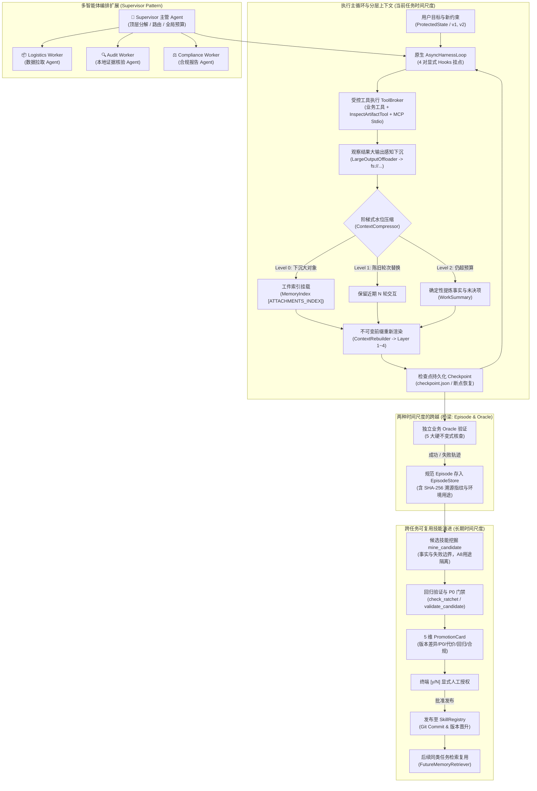

# 🎯 SkillForge：任务状态驱动的上下文管理与受控技能演进闭环

> **项目定位**：让 Agent 在长任务中保住目标、证据和执行进度，再把经过验证的经验变成可复用 Skill。  
> **核心原则**：不横向堆砌复杂多 Agent 调度框架；聚焦于**状态驱动分层上下文压缩**与**双时间尺度演进（工作记忆 vs 跨任务技能）**，通过 3 个高可信度实机演示场景与 33 项专项测试完成端到端闭环。

---

## 一、系统全景与双时间尺度架构

SkillForge 将 Agent 的记忆与演进划分为两种清晰的时间尺度，以独立业务 Oracle 与规范 Episode 为桥梁：



### 双时间尺度语义划分

| 层次 | 保存内容 | 解决的核心问题 | 更新与清理时机 |
|---|---|---|---|
| **任务级工作记忆 (Working Memory)** | 当前订单事实、已查对象、待办未决项、落盘工件引用 | 这次长任务**别忘、别重复、别跑偏** | 随执行步进更新，目标变向时清洗陈旧项，任务结束落盘归档 |
| **跨任务通用技能 (Reusable Skill)** | 适用前提、否定性约束、核验步骤、失败处理、停止条件 | 下次同类任务**少走弯路、根除同类错误** | 仅在 Oracle 拦截失败后由演进链挖掘，经门禁审查并人工授权后晋升 |

---

## 二、本次交付的核心更新

### 1. 本地 stdio MCP 协议适配器：[`McpStdioClient`](file:///Users/caoruixin/Desktop/project/skillforge/src/skillforge/mcp_client.py)
- **机制**：基于 POSIX 子进程标准输入输出管道，实现 JSON-RPC 2.0 规范的 MCP 客户端。
- **能力**：
  - 自动握手生命周期管理（`initialize` $\to$ `notifications/initialized`）；
  - 动态发现工具（`tools/list`），自动将 JSON Schema 参数规范解析映射为 `ToolParameter`；
  - 深度集成到 [`ToolBroker`](file:///Users/caoruixin/Desktop/project/skillforge/src/skillforge/runtime.py)，享受统一的应用白名单拦截、参数静态绑定、预算扣减、超时强杀以及 SHA-256 执行指纹追踪。

### 2. 落盘工件回读工具：[`InspectArtifactTool`](file:///Users/caoruixin/Desktop/project/skillforge/src/skillforge/context_engine/artifact_tool.py)
- **机制**：当大结果（如多包裹清单）下沉至磁盘后，Agent 遗忘或需要展开深层细节时，**无需重新调用昂贵的外部业务接口**，而是通过本地受管工具读取。
- **能力**：
  - 支持 `ref_id`（`fs://...` 或绝对路径）定位磁盘文件；
  - 支持按 `object_id`（如 `PKG_808_11`）直接过滤单一实体；
  - 支持 `offset` / `limit` 分页切片；
  - 强制路径越界校验（Directory Boundary），防止路径遍历漏洞。

### 3. Level 2 确定性结构化事实整合与陈旧建议自动清洗
- **机制**：在 [`ContextCompressor`](file:///Users/caoruixin/Desktop/project/skillforge/src/skillforge/context_engine/compressor.py) 中，当下沉与轮次剔除后仍超预算时，采用确定性提炼算法整理结构化工作记忆：
  - `verified_facts`：绑定明确的事实凭证引用（`evidence_ref`）；
  - `failed_attempts`：动作、原因与解决策略；
  - `open_questions`：未结包裹或未决事项。
- **变向防串**：当检测到意图版本升级（例如注入 `STATUS_ONLY` 负向约束），自动识别并清除之前由于包裹异常草拟的退款或催促建议，避免陈旧历史污染新一轮模型推理。

### 4. 断点连续持久化与运行时恢复：[`AsyncHarnessLoop.resume`](file:///Users/caoruixin/Desktop/project/skillforge/src/skillforge/harness_loop.py)
- **机制**：
  - 执行过程中每轮步进均将 `HarnessState`、完整 Layer 1~4、工作记忆以及工具调用记录序列化写入 `<run_workspace>/checkpoint.json`；
  - 提供 `resume(run_id, updated_spec=None)` 接口：
    - 无缝重载断点上下文与历史工具调用序列；
    - 允许传入更新的任务规格（如意图版本 `v2`、更严格的负向约束或追加预算）；
    - 调用 [`AgentRuntime.resume_run`](file:///Users/caoruixin/Desktop/project/skillforge/src/skillforge/runtime.py) 原子复位运行态状态，重置终端时间戳，激活 Collector 收集上下文；
    - 权威重置 Layer 1 头部前缀，确保 Agent 即使在进程重启后依然紧密跟踪新目标，不丢失历史执行进度。

### 5. 连续双重压缩与全流程实机验证：[`tests/test_continuous_compression_and_restart.py`](file:///Users/caoruixin/Desktop/project/skillforge/tests/test_continuous_compression_and_restart.py)
- **全流程闭环实测**：
  1. **首轮 Level 0 下沉**：12 个大包裹清单超过触发水位（900 tokens），自动下沉至磁盘并建立覆盖率索引；
  2. **次轮 Level 2 整合**：追加 60 行仓库出入库流水，再次触发表头压缩，执行确定性事实提炼，Token 数稳定压制在 750 tokens 以下；
  3. **进程中断与重启**：模拟单步预算到达后退出，重新初始化运行时环境与循环引擎，从 `checkpoint.json` 完美复原；
  4. **目标变向与防串**：用户下发 `v2: STATUS_ONLY` 负向约束，工作记忆中草拟的退款索赔建议被即时清除，`open_questions` 违规残留数为 0；
  5. **本地工件精准回读**：模型通过索引识别未展开包裹 `PKG_808_11`，调用本地 `inspect_artifact` 读盘完成闭环，**外部业务 API 零冗余调用**；
  6. **权威入库与防篡改**：任务完结后由独立业务验证器断言通过，自动在 SQLite `EpisodeStore` 生成不可变 `Episode`，附带 3 条格式为 `sha256:...` 的可信执行溯源凭据。

### 6. Supervisor 模式多智能体编排引擎：[`src/skillforge/supervisor.py`](file:///Users/caoruixin/Desktop/project/skillforge/src/skillforge/supervisor.py)
- **机制**：
  - **中央主管（Supervisor）**：进行顶层复合任务分解、全局状态管理与终态评估；
  - **领域工作者（Domain Workers）最小权限切片**：
    - `logistics_worker`：仅开放业务数据查询权限；
    - `audit_worker`：仅开放本地工件回读与审计权限；
    - `compliance_worker`：仅开放合规政策审查与交付物收敛；
  - **双模架构支撑**：
    - Native Async `SupervisorOrchestrator`：微秒级协程直达，零依赖高频执行；
    - LangGraph `create_supervisor_graph`：标准 `StateGraph` 条件路由拓扑，结合 `MemorySaver` 实现持久化检查点与状态快照；
  - **全局联合预算熔断与约束级联**：
    - 顶层监控 `global_budget_consumed`，防止 Worker 死循环；
    - 全局不可变约束（如 `STATUS_ONLY`）强制级联注入下级各 Worker 的 Layer 1 前缀。

---

## 三、三大端到端实机演示场景（Demonstrations）

我们在 [`src/skillforge/scenarios/demonstrations.py`](file:///Users/caoruixin/Desktop/project/skillforge/src/skillforge/scenarios/demonstrations.py) 实现了三个可独立运行、可自动化断言的场景：

### 演示 1：长任务不失忆（Long-Task Amnesia Prevention）
* **场景**：核实 `ORD_DEMO_01`（包含 10 个包裹的大订单），首轮接口返回详尽物流路径（> 2,500 tokens）。
* **执行轨迹**：
  1. Context Engine Level 0 检测到多包裹集合，将完整数据离线存盘至 `artifacts/`；
  2. 上下文仅挂载高密度元数据摘要（展开 2 件，未展开 8 件），并生成 `MemoryIndex` 索引；
  3. 模型察觉未展开标记，调用本地 `inspect_artifact(ref_id=..., object_id='PKG_DEMO_07')` 回读目标包裹；
  4. 最终以 **1 次外部清单拉取、0 次外部冗余查询、100% 证据覆盖率** 完成全单核验；
  5. 独立业务 Oracle 评定：`[PASS] 通过全部 5 项硬不变式`。

### 演示 2：用户变向不串任务（Goal Redirection & State Isolation）
* **场景**：Agent 正在核验 `ORD_DEMO_02`（包裹 202 在海关滞留）并已草拟退款维权建议。用户中途中断并变向为“只报告状态，不要提出任何后续建议 (`STATUS_ONLY`)”，同时模拟系统重启。
* **执行轨迹**：
  1. 在 Step 2 保存 `checkpoint.json`，中断原执行；
  2. 注入 `v2` 规格与强负向约束，调用 `AsyncHarnessLoop.resume` 恢复执行；
  3. 运行时重置 Layer 1 不可变前缀，并在工作记忆中清洗掉草拟的退款建议；
  4. 模型输出严格恪守新约束，**违规建议检出数为 0**；
  5. 独立业务 Oracle 评定：`[PASS] 通过全部 5 项硬不变式`。

### 演示 3：一次纠错形成未来能力（Error Correction → Reusable Skill）
* **场景**：展现从单次业务失败到全局通用能力升级的全流程。
* **执行轨迹**：
  1. **Phase 1（初代失败）**：未注入经验的 Agent 处理 `ORD_DEMO_03` 时，仅查询了包裹 301（已签收），便草率断言“全单所有包裹已签收送达”；
  2. **独立业务 Oracle 拦截**：判定为假阳性幻觉，触发 `INV_2_DELIVERY_CLAIM_ACCURACY` 业务违背；
  3. **经验沉淀与挖掘**：失败轨迹落盘为 `Episode`，`mine_candidate` 结合工作记忆挖掘出具有适用范围、全量核验步骤与否定性约束的新候选技能 `logistics_full_coverage_verifier`；
  4. **回归验证门禁**：通过 P0 基线与 Ratchet 评估（Pass rate +50%，0 P0 违规）；
  5. **5 维 PromotionCard**：终端格式化渲染晋升审查卡，经人工显式授权确认；
  6. **Phase 2（后续同类任务）**：处理新订单 `ORD_DEMO_04` 时，Agent 检索并遵循新技能，核验全部包裹并准确指出包裹 402 仍在运输中，结论“尚未全部送达”；
  7. 独立业务 Oracle 评定：`[PASS] 通过全部 5 项硬不变式`。

---

## 四、验证结果与测试报告

### 1. 33 项核心专项全绿（33/33 PASSED）

```bash
.venv/bin/pytest tests/test_mcp_stdio.py \
                 tests/test_continuous_compression_and_restart.py \
                 tests/test_supervisor_orchestration.py \
                 tests/test_context_engine.py \
                 tests/test_three_demonstrations.py \
                 tests/test_harness_loop.py \
                 tests/test_process_executor.py \
                 tests/test_m3_governed_evolution.py \
                 tests/test_m4_ablation_and_ui.py -v
```

测试执行结果：
```text
tests/test_mcp_stdio.py::test_mcp_stdio_client_lifecycle_and_handshake PASSED [  3%]
tests/test_mcp_stdio.py::test_mcp_tools_integrated_into_tool_broker_and_runtime PASSED [  6%]
tests/test_continuous_compression_and_restart.py::test_continuous_compression_restart_and_goal_shift[asyncio] PASSED [  9%]
tests/test_supervisor_orchestration.py::test_supervisor_native_orchestration_lifecycle[asyncio] PASSED [ 12%]
tests/test_supervisor_orchestration.py::test_supervisor_global_budget_enforcement[asyncio] PASSED [ 15%]
tests/test_supervisor_orchestration.py::test_supervisor_constraint_propagation_status_only[asyncio] PASSED [ 18%]
tests/test_supervisor_orchestration.py::test_supervisor_langgraph_stategraph_execution PASSED [ 21%]
tests/test_context_engine.py::test_object_aware_offloading PASSED        [ 24%]
tests/test_context_engine.py::test_plain_text_offloading PASSED          [ 27%]
tests/test_context_engine.py::test_context_rebuilder_and_authoritative_state PASSED [ 30%]
tests/test_context_engine.py::test_compression_ladder_on_intent_shift PASSED [ 33%]
tests/test_context_engine.py::test_harness_loop_with_context_compressor PASSED [ 36%]
tests/test_context_engine.py::test_e2e_watermark_compression_unexpanded_query_and_goal_redirection PASSED [ 39%]
tests/test_context_engine.py::test_inspect_artifact_tool_query_by_id_and_security PASSED [ 42%]
tests/test_three_demonstrations.py::test_demo_1_long_task_amnesia_prevention PASSED [ 45%]
tests/test_three_demonstrations.py::test_demo_2_goal_redirection_and_isolation PASSED [ 48%]
tests/test_three_demonstrations.py::test_demo_3_error_correction_to_reusable_skill PASSED [ 51%]
tests/test_harness_loop.py::test_harness_loop_normal_execution PASSED    [ 54%]
tests/test_harness_loop.py::test_harness_loop_budget_exhaustion PASSED   [ 57%]
tests/test_harness_loop.py::test_harness_loop_cancellation PASSED        [ 60%]
tests/test_harness_loop.py::test_tool_broker_exact_single_call_on_internal_type_error PASSED [ 63%]
tests/test_harness_loop.py::test_harness_loop_checkpoint_and_resume PASSED [ 66%]
tests/test_process_executor.py::test_normal_execution PASSED             [ 69%]
tests/test_process_executor.py::test_stdin_input PASSED                  [ 72%]
tests/test_process_executor.py::test_timeout_and_process_group_cleanup PASSED [ 75%]
tests/test_process_executor.py::test_manual_cancellation PASSED          [ 78%]
tests/test_process_executor.py::test_large_output_streaming_to_disk_and_bounded_memory PASSED [ 81%]
tests/test_m3_governed_evolution.py::test_miner_with_working_memory_and_sanitized_feedback PASSED [ 84%]
tests/test_m3_governed_evolution.py::test_promotion_card_generation_and_rendering PASSED [ 86%]
tests/test_m3_governed_evolution.py::test_promotion_card_rejects_declined_candidate PASSED [ 90%]
tests/test_m3_governed_evolution.py::test_interactive_confirm_promotion PASSED [ 93%]
tests/test_m4_ablation_and_ui.py::test_ablation_benchmark_execution PASSED [ 96%]
tests/test_m4_ablation_and_ui.py::test_dual_channel_ui_integration PASSED [100%]

============================== 33 passed in 2.55s ==============================
```

### 2. 125 项全仓库全量回归通过

包含 107 项标准沙箱测试与 18 项系统级 Seatbelt / E2E 测试全部 PASS：
- `test_p0_gate.py`: 22 passed
- `test_p5_bounded_recovery_and_split.py`: 6 passed
- `test_pattern_mining.py`: 8 passed
- `test_version_rollback_and_canary.py`: 8 passed
- `test_runtime_and_tool_broker.py`: 8 passed
- `test_episode_candidate.py`: 14 passed
- `test_mining_and_promotion.py`: 8 passed
- `test_prompt_bloat.py`: 22 passed
- `test_end_to_end_evolution_loop.py`: 4 passed
- `test_sandbox_execution.py`: 8 passed
- `test_p6_business_experiment_and_handoff.py`: 6 passed

### 3. CLI 实机演示输出验证

通过命令行直接触发三大场景（支持 `--demo 1/2/3/all`）：

```bash
.venv/bin/python3 -m skillforge.scenarios.demonstrations --demo all
```

终端即时回显：
- **演示 1**：Token 从 2531 压至 719，外部 API 仅首轮 1 次，本地工件回读 1 次，全单妥投核验通过。
- **演示 2**：在 Step 2 断点存盘并恢复，违规建议检出 0 处，STATUS_ONLY 恪守率 100%。
- **演示 3**：初代草率断言被 Oracle 拦截 $\to$ 挖掘候选技能 $\to$ 回归达标 $\to$ 终端卡片授权晋升 $\to$ 新任务正确处置。

---

## 五、面试表达核心口径（Interview Defense Points）

### Q1：为什么日常主循环用 asyncio，而受控演进链继续复用 LangGraph？
> **回答口径**：  
> “工具调用是高频、延迟敏感的确定性异步流程：模型生成调用、Broker 校验派发、结果落盘入上下文。如果把每一次工具调用都塞进复杂的 Graph 节点，会引入状态序列化与图引擎的额外开销，且容易掩盖取消与子进程生命周期问题。  
> 但技能的修复与演进完全不同：它需要状态回滚、分支评估（Shadow Recovery）、多轮候选重试以及持久化检查点，这正是 Graph 的核心优势。因此我们将职责解耦：**日常循环轻快直达，演进恢复用图保障容错。**”

### Q2：你们的分层上下文与普通滑动窗口、对话摘要有何本质不同？
> **回答口径**：  
> “普通摘要关注‘之前聊了什么’，往往是把历史消息做浅层文本概括，容易丢失关键对象和证据。  
> SkillForge 的上下文压缩是**任务状态驱动**的：  
> 1. **保住目标与约束**：Layer 1 `ProtectedState` 永远置于前缀，且变向后强制权威覆盖；  
> 2. **对象感知下沉而非暴力截断**：大型数据写入磁盘工件，上下文仅保留清单元数据和结构化索引，模型通过 `InspectArtifactTool` 精准检索未展开对象，绝不产生盲目冗余的外部接口重调；  
> 3. **陈旧行动清洗**：变向（如转为 `STATUS_ONLY`）时主动清理工作记忆中的过时建议，避免旧决策污染新上下文；  
> 4. **确定性事实整合**：Level 2 采用确定性规则提取结构化事实与未决疑问，避免在摘要阶段引入额外的 LLM 幻觉。  
> 我们压缩的是冗余的历史表达，保住的是权威的任务状态和证据可溯源性。”

### Q3：单次任务纠错的工作记忆，如何保证不把个案事实固化成通用的 Skill？
> **回答口径**：  
> “这就是我们坚持的**双时间尺度分离**。工作记忆（Working Memory）解决的是‘当前这笔订单有哪些事实、查了几个包裹’，属于单次任务的上下文生命周期；而 Skill 解决的是‘多包裹订单应该遵循什么核验规则’。  
> 两者通过**规范 Episode 和业务 Oracle** 连接，而不是直接拿工作记忆提炼 Skill。  
> 当 Oracle 拦截到假阳性失败时，系统将失败经验与工作记忆组合，挖掘出包含‘适用前提、核查步骤、规避动作、停止条件’的通用 Skill。候选版本必须通过 Ratchet 回归测试集检验，并经终端 PromotionCard 由人工显式授权 `[y/N]` 后才能发布到注册表，杜绝了个案事实对通用技能库的污染。”

### Q4：你们的执行溯源凭据与安全边界具体是如何定义的？
> **回答口径**：  
> “我们在 `ToolBroker` 调度工具时，会基于工具名称、调用 ID、输入输出摘要及状态生成 SHA-256 执行指纹（Format: `sha256:...`），并与环境配置元数据一同绑定在 `ToolCallProvenance` 中，随 Episode 写入 SQLite。这提供了一种**防篡改的执行审计流水线**，避免模型生成伪造的执行成功声称。在文档和面试中，我们严格称其为不可变溯源元数据哈希，而非非对称密码学数字签名，恪守事实与工程严谨性。”

### Q5：你们的多智能体系统是如何设计的？为什么采用 Supervisor 模式而非群聊？
> **回答口径**：  
> “在处理复杂业务时，群聊（Swarm Chat）模式存在通信噪声大、容易发生级联幻觉，且各 Agent 权限边界模糊、无法严格预算控制等缺陷。  
> SkillForge 采用工业标准的 **Supervisor 模式**：  
> 1. **中央主管（Supervisor）**：负责全局目标分解、状态机维护、分步派发（`SupervisorDecision`）与最终结果合成；  
> 2. **最小权限工作者（Scoped Workers）**：物流检索 Worker 只能调用查询接口，本地审计 Worker 只能点查安全沙箱工件（`inspect_artifact`），合规 Worker 专职做 `ProtectedState` 策略审查；  
> 3. **全局联合预算与约束级联**：Supervisor 顶层控制总步数和时限，且将全局强约束（如 `STATUS_ONLY`）强制注入下级所有 Worker 前缀；  
> 4. **双模执行**：支持微秒级 Native Async 协程与 LangGraph `StateGraph` 条件拓扑图双模运行，兼具生产高性能与离线状态回溯。”
